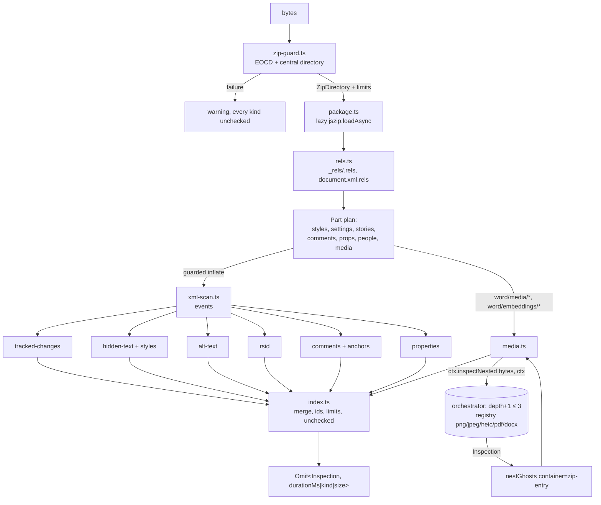

# Design Document

## Overview

The DOCX extractor works in four stages, each bounded by size and time limits:

1. **Guard** (`zip-guard.ts`, pure): reads the ZIP's End of Central Directory record and every central-directory record directly from the bytes, then applies the limits (entry count, declared sizes, ratio, overlapping data ranges, duplicates, encryption flag, method) *before* any decompression.
2. **Open** (`package.ts`): lazily imports jszip, loads the archive, and inflates only the parts it needs, through a byte-counting stream that stops at the declared size or the per-entry cap.
3. **Scan** (`xml-scan.ts`): a streaming, namespace-aware, never-throwing XML tokenizer. Visitors (`visitors/*.ts`) consume one event stream per part and gather ghost drafts in one pass.
4. **Recurse** (`media.ts`): sends each embedded-media candidate to `ctx.inspectNested(bytes, ctx)` and wraps the result with the core `nestGhosts(inner, { type: 'zip-entry', path })`.

`index.ts` merges the drafts, numbers ids per kind, applies output limits and builds `unchecked`.

## Architecture

### Files

```
packages/core/src/extractors/docx/
  index.ts             export const extractor: Extractor; orchestration, limits, ids, unchecked
  zip-guard.ts         readCentralDirectory(bytes) -> ZipDirectory | ZipGuardFailure; applyLimits()
  package.ts           openPackage(): jszip load, guarded inflate, relationship graph, part discovery
  rels.ts              parse .rels parts, resolve targets
  xml-scan.ts          scanXml(text, opts) generator; decodePart(bytes) -> string
  namespaces.ts        NS constants (w, w14, w15, wp, pic, a, r, v, o, cp, dc, dcterms, vt, ep, rel, ct)
  styles.ts            styles.xml -> StyleTable (vanish resolution through basedOn)
  visitors/
    tracked-changes.ts
    comments.ts        comments.xml + commentsExtended.xml + anchors from main part
    rsid.ts
    properties.ts      core/app/custom/customXml/people/attachedTemplate (+ author-identity, software-trail, capture-time)
    hidden-text.ts
    alt-text.ts
  media.ts             nested inspection via ctx.inspectNested + core nestGhosts
  limits.ts            numeric limits (single source, imported by tests)
  *.test.ts, docx.prop.test.ts, xml-scan.prop.test.ts, zip-guard.prop.test.ts
packages/core/src/extractors/shared/pii-patterns.ts   (from pdf-ghosts task 1.2)
```

### Data flow



### Part processing order

`[Content_Types].xml` → `_rels/.rels` → the main part's `.rels` → `styles.xml` (needed by hidden-text) → `settings.xml` and its `.rels` → the main part → headers, footers, footnotes, endnotes → `comments.xml`, `commentsExtended.xml`, `people.xml` → docProps → `customXml/item*.xml` → media. Comment anchors are gathered while the main part is scanned, then joined to comments afterwards.

## Components and Interfaces

```ts
// zip-guard.ts
export interface ZipEntryRecord {
  name: string;               // decoded as UTF-8 if flag bit 11 is set, else CP437
  method: number;             // 0 store, 8 deflate, others unsupported
  flags: number;              // bit 0 = encrypted
  compressedSize: number;
  uncompressedSize: number;   // declared; Zip64 extra field honoured
  localHeaderOffset: number;
  dataRange: { start: number; end: number }; // from local header (30 + n + m) + compressedSize
  crc32: number;
}
export interface ZipDirectory { entries: ZipEntryRecord[]; zip64: boolean; commentLength: number }
export type ZipGuardFailure = { ok: false; code: 'docx-not-a-package' | 'zip-too-many-entries' | 'zip-overlapping-entries' | 'zip-size-limit'; message: string };
export function readCentralDirectory(bytes: Uint8Array): { ok: true; dir: ZipDirectory; warnings: Warning[] } | ZipGuardFailure;
export interface LimitDecision { allowed: ZipEntryRecord[]; skipped: { entry: ZipEntryRecord; code: string }[]; duplicates: string[][] }
export function applyLimits(dir: ZipDirectory, limits: DocxLimits): LimitDecision;

// limits.ts
export interface DocxLimits {
  maxEntries: 10_000; maxTotalUncompressed: 512 * 1024 * 1024; maxEntryUncompressed: 128 * 1024 * 1024;
  maxRatio: 200; ratioMinSize: 1024 * 1024; maxXmlPart: 64 * 1024 * 1024; maxMediaEntry: 64 * 1024 * 1024;
  maxMediaEntries: 200; maxGhosts: 1_000; maxEvidenceString: 1_000; maxDepth: 3;
}
export const DOCX_LIMITS: DocxLimits;

// package.ts
export interface DocxPackage {
  readPart(path: string, signal?: AbortSignal): Promise<{ ok: true; bytes: Uint8Array } | { ok: false; code: string; message: string }>;
  readDuplicateCopies(path: string): Promise<Uint8Array[]>;   // non-jszip copies via DecompressionStream('deflate-raw') when available
  has(path: string): boolean;
  paths(): readonly string[];
  rels(sourcePart: string): Promise<Relationship[]>;
  mainPart: string;
}
export interface Relationship { id: string; type: string; target: string; resolved: string | null; external: boolean }
export function openPackage(bytes: Uint8Array, dir: ZipDirectory, decision: LimitDecision, signal?: AbortSignal): Promise<{ pkg: DocxPackage; warnings: Warning[] }>;

// xml-scan.ts
export interface QName { prefix: string; local: string; ns: string }       // ns '' when unbound
export interface XmlAttr { name: QName; value: string }
export type XmlEvent =
  | { type: 'open'; name: QName; attrs: readonly XmlAttr[]; selfClosing: boolean; path: string; offset: number }
  | { type: 'close'; name: QName; offset: number; synthetic: boolean }
  | { type: 'text'; text: string; offset: number; cdata: boolean };
export interface XmlScanOptions { maxDepth?: number; maxAttrs?: number; maxNameLength?: number; maxText?: number }
export interface XmlScanSummary { warnings: Warning[]; events: number }
export function scanXml(text: string, opts?: XmlScanOptions): Generator<XmlEvent, XmlScanSummary, void>;
export function decodePart(bytes: Uint8Array): { text: string; encoding: 'utf-8' | 'utf-16le' | 'utf-16be'; warnings: Warning[] };
export function attr(ev: Extract<XmlEvent, { type: 'open' }>, ns: string, local: string): string | undefined;

// visitors: each is a small push-based state machine
export interface PartContext { path: string; story: boolean; styles: StyleTable; rels: readonly Relationship[] }
export interface Visitor {
  onEvent(ev: XmlEvent, stack: readonly QName[], part: PartContext): void;
  onPartEnd(part: PartContext): void;
  finish(): DetectorResult;                          // after all parts
}
export type GhostDraft = Omit<Ghost, 'id'>;
export interface DetectorResult { ghosts: GhostDraft[]; warnings: Warning[]; unchecked: GhostKind[] }

// styles.ts
export interface StyleTable { isHidden(styleId: string): boolean; via(styleId: string): string | null }
export function buildStyleTable(events: Iterable<XmlEvent>): StyleTable;   // basedOn chain ≤ 10, cycle-safe

// media.ts
export function inspectMedia(pkg: DocxPackage, candidates: readonly string[], ctx: ExtractContext): Promise<DetectorResult>;  // uses nestGhosts from '../../nested'
```

### Why a hand-written XML scanner

| Option | Runs in browser, worker and Node | Never throws on bad XML | No entity expansion | Size (min+gz) | Namespaces | Verdict |
|---|---|---|---|---|---|---|
| `DOMParser` | browser only | yes (parsererror doc) | partly | 0 | yes | ruled out: not in Node or workers in all targets, and a DOM API in core |
| `fast-xml-parser` | yes | no (throws, validator separate) | configurable; has had ReDoS and prototype-pollution CVEs | ~12 KB | no real resolution | builds a whole tree, too heavy for 64 MB parts |
| `saxes` | yes | no (strict, throws) | yes | ~9 KB | yes | partial results lost on first error |
| `sax` | needs a `stream` polyfill | non-strict mode tolerant | yes | ~11 KB | optional | polyfill cost, unmaintained |
| `txml` | yes | mostly | yes | ~2 KB | no | recursive, so a stack overflow on deep nesting |
| **own `xml-scan.ts`** | yes | yes, by design | yes (only predefined + numeric) | ~2 KB | yes | **chosen** |

OOXML needs only a small part of XML: elements, attributes, namespaces, text, CDATA and five entities. A ~300-line scanner covers that. It is fuzzed by xml-scan properties 1–4 and by the Paw's P4, which matches the steering rule to keep hand-written parsers "small and fully tested", and adds no dependency.

**Scanner internals.** It works on a decoded `string`, with a cursor and `indexOf` searches for `<`, `>`, quotes and `]]>`, so every character is visited a bounded number of times (linear). A scope stack holds `{ prefix → ns }` maps plus the element QName and a per-depth child counter for positional paths. Attribute values are entity-decoded, and line breaks inside them become spaces. Recovery rules: an unmatched close pops to the nearest matching open element (emitting synthetic closes), or is dropped if none matches; at end of input, every open element gets a synthetic close. The generator returns `XmlScanSummary` with warnings, and callers check `signal` every 8,192 events.

### Guarded inflate

jszip's `file.internalStream('uint8array')` emits `data` chunks. `readPart` adds up the chunk lengths. Once the total passes `min(declared, cap)`, it calls `pause()`, drops the stream, discards the buffers and returns `{ ok: false, code: 'zip-size-mismatch' }`. Declared sizes come from the guard's central directory, not jszip's internal fields. If jszip's CRC check is off (`checkCRC32: false`), the guard compares CRC-32 after inflate and adds `zip-crc-mismatch` on mismatch, but keeps the content, because a tampered part may still hold ghosts.

**Duplicates.** jszip keeps one entry per name. The guard knows every copy's data range, so `readDuplicateCopies` inflates the other copies with `DecompressionStream('deflate-raw')`, using the same byte counter. Where that API is missing, the copies are listed in `docx-duplicate-unchecked`, and that part's kinds go to `unchecked`.

### Visitors (single pass per part)

- **tracked-changes:** watches for the change elements in Req 5.1. While inside one, it gathers text from `w:t`, `w:delText` and `w:delInstrText`. Nested changes (a `w:del` inside a `w:ins`) are reported separately. The innermost one gets the text.
- **hidden-text:** tracks `w:p`, then `w:pPr/w:pStyle`, then `w:r`, `w:rPr/(w:vanish|w:specVanish|w:rStyle)` and `w:t`. A run is hidden if it has direct vanish, or vanish through its rStyle or the paragraph's pStyle (via `StyleTable`).
- **alt-text:** reads `wp:docPr`, `pic:cNvPr`, `v:shape`/`v:imagedata` and `a:blip/@r:embed`, which resolves to the image part.
- **rsid:** collects every attribute in the `w` namespace whose local name starts with `rsid`, plus settings `w:rsids`. Also counts `w14:paraId`/`w14:textId`.
- **comments:** runs in two phases. Main-part anchors map `w:commentRangeStart/@w:id` to the text up to the matching end. The comments part gives comment elements and the last paragraph's `w14:paraId`. `commentsExtended` gives the `done` flags.
- **properties:** `cp:coreProperties` children; `ep:Properties` children; `op:Properties/op:property/@name` plus its `vt:*` child text; customXml leaves; `w15:people`; and `attachedTemplate` from `word/_rels/settings.xml.rels`.

### Nested wrapping

`media.ts` uses the core helper and leaves depth and propagation to the orchestrator:

```ts
for (const path of candidates) {                       // word/media/*, word/embeddings/*, ≤ 200, ≤ 64 MB each
  const read = await pkg.readPart(path, ctx.signal);
  if (!read.ok) { skipped(path, read.code); continue; } // docx-media-unchecked + unchecked ∋ embedded-media-ghost
  const inner = await ctx.inspectNested(read.bytes, ctx); // orchestrator: depth+1, max 3, records it for 7.5 propagation
  drafts.push(...nestGhosts(inner, { type: 'zip-entry', path }));
}
```

`nestGhosts` (ghost-model Requirement 7.4) sets `kind: 'embedded-media-ghost'`, the inner severity and confidence, `title: "Inside <innerKind>: <inner title>"`, `location: { type: 'nested', container, inner: g.location, innerKind: inner.kind }` and `evidence.raw: { innerGhost: g }`. A DOCX inside `word/embeddings/` comes back with its own `embedded-media-ghost`s. Wrapping them again gives `nested` inside `nested`, so the full path is kept. The orchestrator refuses depth 4 (`max-depth`), copies nested warnings as `nested:<code>`, and adds `embedded-media-ghost` to `unchecked` when any nested inspection has warnings or unchecked kinds. The extractor adds `docx-media-unchecked` only for entries it skipped itself.

## Data Models

| Kind | Location | Key fields | Severity | Confidence |
|---|---|---|---|---|
| `tracked-change` | `zip-entry` + xpath | Change, Author, Date, Text, Change id, Part, (Count) | wraith (deletion with text) / shade | 1.0 |
| `comment` | `zip-entry` (`word/comments.xml`) + xpath | Author, Initials, Date, Text, On text, Resolved | wraith | 1.0 |
| `revision-id` | `zip-entry` (`word/settings.xml`, `/w:settings[1]/w:rsids[1]`) | rsidRoot, Distinct sessions, Sample, Also present | shade | 1.0 |
| `docx-properties` | `zip-entry` (props part) | every non-empty field | wraith (path) / shade / wisp | 1.0 |
| `author-identity` | `zip-entry` (core/app/people part) | Name, Roles / Author, Provider, User id | wraith / revenant (people with email or SID) | 0.95 |
| `software-trail` | `zip-entry` (app or settings part) | Application, AppVersion, Attached template | wisp | 1.0 |
| `capture-time` | `zip-entry` (core or app part) | Created, Modified, Last printed, Total editing time | wisp | 1.0 |
| `hidden-text` | `zip-entry` + xpath of first run | Text, Part, Via | wraith (PII) / shade | 0.95 |
| `alt-text` | `zip-entry` + xpath of docPr | Description, Title, Image part, Part | wraith (PII) / shade | 1.0 |
| `embedded-media-ghost` | `nested` | inner fields | inner | inner |

`evidence.raw` per kind: `TrackedChangeRaw { change, author, date, id }`, `RsidRaw { root, values }`, and `NestedGhostRaw { innerGhost }` (core `nested.ts`) for `embedded-media-ghost`.

## Proposed change to types.ts

```ts
export type GhostKind =
  // ...existing kinds unchanged
  | 'hidden-text'              // DOCX w:vanish / specVanish runs (and styles that set vanish)
  | 'alt-text';                // image descriptions/titles (wp:docPr, pic:cNvPr, VML alt)
```

Effects, and what follows from them:
- `GHOST_KINDS` (ghost-model spec) gains both kinds after `'docx-properties'`. `carries('docx')` gains both. The exhaustiveness check in `ghost-kinds.ts` enforces this at compile time.
- The DOCX exorcist's `removes` should include both (the exorcism spec follows through the `types-changed` hook). The vellum UI needs ledger copy for them.
- The Paw adds planters for both (the-paw `PLANTERS`).

Nothing else changes. `NestedGhostRaw` and `nestGhosts` already exist in core `nested.ts` (ghost-model spec), and this extractor uses them as they are. If the change is declined, Requirements 9 and 10 are postponed. Hidden text and alt text will not be filed under another kind.

## Error Handling

| Condition | Behaviour | Warning | `unchecked` |
|---|---|---|---|
| Not a ZIP / no EOCD / no main part | stop | `docx-not-a-package` | all |
| > 10,000 entries | stop before jszip | `zip-too-many-entries` | all |
| Overlapping data ranges | stop before jszip | `zip-overlapping-entries` | all |
| Total declared > 512 MB | stop | `zip-size-limit` | all |
| Entry > 128 MB, or ratio > 200:1 above 1 MB | skip entry | `zip-size-limit` / `zip-ratio-limit` | that part's kinds |
| Inflate passes declared size or cap | abort entry | `zip-size-mismatch` | that part's kinds |
| Encrypted entry / unsupported method | skip | `zip-entry-unsupported` | that part's kinds |
| Duplicate names | inspect every copy | `zip-duplicate-entry` (+ `docx-duplicate-unchecked`) | as needed |
| jszip throws on load | stop | `docx-not-a-package` (message) | all |
| CRC mismatch | keep content | `zip-crc-mismatch` | — |
| XML part > 64 MB | skip | `docx-part-too-large` | that part's kinds |
| Malformed XML / DOCTYPE / unknown entity / limits | recover | `xml-malformed` / `xml-doctype-ignored` / `xml-unknown-entity` / `xml-limit` (offset = char index) | — |
| Main part guessed | continue | `docx-main-part-guessed` | — |
| > 100 changes in a part | group | `docx-changes-grouped` | — |
| Media skipped by the extractor (size, > 200, inflate failure) | skip | `docx-media-unchecked` / `docx-media-truncated` | `embedded-media-ghost` |
| Nested depth 4, nested warnings, nested unchecked | handled by the orchestrator | `max-depth`, `nested:<code>` | `embedded-media-ghost` (added by orchestrator) |
| > 1,000 ghosts | stop emitting | `docx-ghost-limit` | kinds over the limit |
| Abort signal | return partial | `budget-exceeded` | unfinished kinds |

Kinds per part, used for `unchecked`: main/story parts → `tracked-change`, `hidden-text`, `alt-text`, `revision-id`, and `comment` anchors; comments part → `comment`; settings → `revision-id`, `docx-properties`; docProps/people/customXml → `docx-properties`, `author-identity`; docProps → also `software-trail`, `capture-time`; media → `embedded-media-ghost`.

## Correctness Properties

DOCX inputs come from the Paw's `DocxRecipe` arbitrary and builder (`paw/gen/docx-writer.ts`). XML trees come from a local `xmlTreeArb`.

1. **Scanner totality.** For any string up to 256 KiB (arbitrary, or XML with random mutations), `scanXml` finishes without throwing, its event count is ≤ the input length + 1, and every `open` has exactly one matching `close` (real or synthetic), in order.
2. **Scanner round-trip.** For any element tree (random namespace prefixes, attributes, and text with `<>&"'`, astral characters and CDATA), serializing with escaping and then scanning gives back the same tree of expanded names, attribute values and concatenated text.
3. **Prefix independence.** For any tree and any two prefix assignments for the same namespaces, the event streams are equal up to `QName.prefix` and `path`.
4. **No entity expansion.** For any document with a DOCTYPE declaring entities (including nested billion-laughs definitions) and references to them, the total text length emitted is ≤ the input length, and no declared replacement text appears unless it occurs literally outside the DOCTYPE.
5. **Guard agrees with the writer.** For any package built by the Paw zip writer (store or deflate, with or without Zip64), `readCentralDirectory` returns entries whose names, sizes, methods and data ranges equal the writer's manifest.
6. **Overlapping entries are refused.** For any package where the writer is told to point two central records at overlapping local data, `extract` returns `zip-overlapping-entries` and every kind in `unchecked`, and jszip is never called (checked through a spy on the loader).
7. **Inflate stays within declared size.** For any entry whose real inflated size is more than its declared size, `readPart` returns `zip-size-mismatch`, and the bytes it buffered never pass the declared size plus one chunk (64 KiB).
8. **Tracked changes.** For any DOCX recipe with `n` tracked changes (≤ 100 per part), there are exactly `n` `tracked-change` ghosts, and for each planted change its author, ISO date and text (cut to 500 characters) appear in the fields of a ghost with the matching `Change` type.
9. **Comments.** For any recipe with comments, the number of `comment` ghosts equals the number of planted comments, and each one's author, text and `Resolved` flag match.
10. **Rsids.** There is exactly one `revision-id` ghost if and only if the recipe plants at least one rsid, and `raw.values` equals the sorted set of planted rsid values.
11. **Properties and authors.** For any recipe's docProps, every planted non-empty value appears in a `docx-properties` ghost of the right part, and the set of `author-identity` names equals the set of distinct planted creator, lastModifiedBy and Manager names (plus people.xml entries with an email-shaped userId).
12. **Hidden text.** For any paragraph recipe, a `hidden-text` ghost containing the run text is reported if and only if the run is hidden directly or through a style chain, and its text is not whitespace only.
13. **Alt text.** An `alt-text` ghost is reported if and only if the planted description or title is non-empty and not a default name.
14. **Nested equals standalone.** For any DOCX recipe embedding a PNG or JPEG curse, the multiset of `(raw.innerGhost.kind, location.inner, severity)` from its `embedded-media-ghost`s whose `location.container.path` is that media path equals the multiset of `(kind, location, severity)` from `inspect(imageBytes)` called directly (ids and `durationMs` ignored).
15. **Depth limit.** For any chain of `L` DOCX layers (the top-level file counts as layer 1, at depth 0) with a planted image ghost in the innermost layer (so the image is inspected at depth `L`), the ghost is reported with `L` nested `nested` locations if `L ≤ 3`, and otherwise it is not reported, `embedded-media-ghost` is in `unchecked`, and the top-level warnings include a code ending in `max-depth`.
16. **Totality and immutability.** For any arbitrary or mutated input up to 1 MB, `extract` resolves, its output passes `InspectionSchema` (partial), the input is unchanged, and `durationMs` is within the G5 budget.

## Testing Strategy

- **Unit tests:** `xml-scan.test.ts` (entities, CDATA, PIs, DOCTYPE skipping, malformed recovery, UTF-16 BOM, positional paths), `zip-guard.test.ts` (EOCD with a comment, Zip64, CP437 versus UTF-8 names, the encryption flag), `rels.test.ts` (relative and absolute targets, External), `styles.test.ts` (basedOn cycles), and one test per visitor using small hand-written XML strings.
- **Property tests:** properties 1–16 above, in `xml-scan.prop.test.ts`, `zip-guard.prop.test.ts` and `docx.prop.test.ts`.
- **Real-world shape tests:** structural fixtures generated by `scripts/make-fixtures.ts` that copy the part layout of Word, LibreOffice and Google Docs exports (synthetic content only; the `haunted-asset-guard` hook checks this).
- **Hostile fixtures:** generated by the Paw zip writer: a 42.zip-style nested bomb (stopped by the ratio and size limits), an overlapping-entry bomb (Fifield-style), duplicate `word/document.xml` copies, and a DOCTYPE billion-laughs document.
- **Budget:** a 50 MB generated document must finish within the G5 budget (2 s/MB) in Node CI. This is a separate, slow-marked test.
