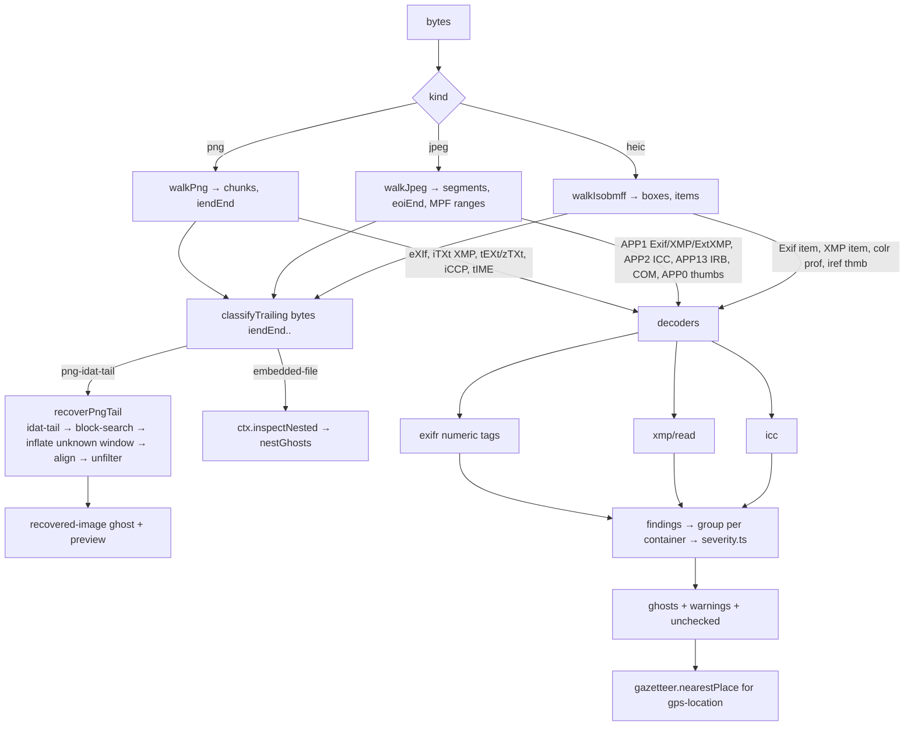

# Design Document

## Overview

The image extractors turn PNG, JPEG and HEIC bytes into ghosts with exact locations, so that the Séance Ledger can point at them and the exorcists can remove them. They are built in three layers:

1. **Walkers**: hand-written, small and fully tested. `walkPng` gives chunks and `iendEnd`. `walkJpeg` gives segments, `eoiEnd` and MPF ranges. `walkIsobmff` gives HEIC boxes and item extents. Walkers only locate bytes. They never interpret metadata.
2. **Decoders**:
   - `exifr` for TIFF/Exif/GPS/IFD1/IPTC, with numeric tag ids;
   - a small namespace-aware XMP reader (`DOMParser` does not exist in workers);
   - an ICC tag reader;
   - PNG text-chunk decoders;
   - one hand-written inflater that serves both normal zlib decoding (`zTXt`, `iTXt`, `iCCP`) and aCropalypse tail decoding. Tail decoding needs a mid-stream bit offset and an unknown window, which fflate and pako don't support.
3. **Mappers**: pure functions that turn decoded fields into `Ghost`s. They use the severity rules in "Data Models" and the evidence and copy conventions.

aCropalypse reconstruction follows the approach Simon Aarons and David Buchanan published for CVE-2023-21036. The vulnerable tools opened the original file for writing without truncating it, so the bytes after the new IEND are the end of the original, larger PNG's IDAT zlib stream. We find a deflate block boundary in that tail, inflate it with an unknown 32 KiB window, align scanlines from the end of the stream using a guessed width, unfilter, and render the rows we can decode. Pixels that depend on overwritten data are shown as transparent. They are never guessed.

## Architecture

### File layout

```
packages/core/src/
  extractors/
    png/
      index.ts            export const extractor: Extractor (kind 'png')
      walk.ts             walkPng
      text.ts             tEXt/zTXt/iTXt + "Raw profile type" decoding
      acropalypse/
        idat-tail.ts      rebuild deflate stream from tail (Req 3.2)
        block-search.ts   findBlockStarts (Req 3.3)
        align.ts          width/bpp scoring from the end (Req 3.5)
        unfilter.ts       filters 0–4 with known-mask (Req 3.6)
        recover.ts        recoverPngTail orchestration
    jpeg/
      index.ts            export const extractor: Extractor (kind 'jpeg')
      walk.ts             walkJpeg, parseMpf
      thumbnails.ts       IFD1 / JFIF / JFXX / IRB thumbnails
    heic/
      index.ts            export const extractor: Extractor (kind 'heic')
      isobmff.ts          walkIsobmff, resolveItems (iinf/iloc/iref)
    shared/
      trailing.ts         classifyTrailing, trailingGhost
      exif.ts             runExifr (dynamic import), mapExif → findings
      xmp/read.ts         namespace-aware XMP tokenizer + property reader
      xmp/map.ts          mapXmp → findings
      iptc.ts             mapIptc → findings
      icc.ts              parseIcc, isStandardIcc
      findings.ts         Finding → Ghost (grouping, severity, copy)
      severity.ts         severity rules (pure, table-driven)
  util/
    inflate.ts            inflateZlib, inflateRaw (with optional known-mask)
    crc32.ts, adler32.ts
    png-encode.ts         encodePngStored (preview fallback)
    downscale.ts          box-filter RGBA downscale preserving alpha=0 for unknown
  geo/
    gazetteer.ts          nearestPlace, formatPlace, lazy loader
    cities.generated.ts   generated by scripts/build-gazetteer.ts (committed)
  paw/gen/                (owned by the-paw spec: png-writer, jpeg-writer, tiff-writer, xmp-writer, icc-writer, deflate)
    heic-writer.ts        added by this spec (synthetic ftyp/meta/iinf/iloc/iref/colr; no HEVC payload)
    deflate-dynamic.ts    added by this spec, test-only: dynamic-Huffman blocks with recorded boundaries (Property 6)
apps/web/src/ui/
  gps-evidence.ts         coordinates + offline place + opt-in button
  opt-in-map.ts           the ONLY module that builds tile URLs
```

### Data flow



## Components and Interfaces

```ts
// walkers
export interface PngChunk { type: string; start: number; dataStart: number; dataEnd: number; end: number; crcOk: boolean }
export function walkPng(bytes: Uint8Array, signal?: AbortSignal):
  { chunks: PngChunk[]; iendEnd: number | undefined; ihdr?: Ihdr; plte?: Uint8Array; warnings: Warning[] };
export interface Ihdr { width: number; height: number; bitDepth: number; colorType: 0 | 2 | 3 | 4 | 6; interlace: 0 | 1 }

export type JpegLabel = 'JFIF' | 'JFXX' | 'Exif' | 'XMP' | 'ExtendedXMP' | 'ICC' | 'MPF' | 'IRB' | 'Adobe'
  | 'COM' | 'SOF' | 'DQT' | 'DHT' | 'DRI' | 'SOS' | 'APPn' | 'other';
export interface JpegSegment { marker: number; start: number; payloadStart: number; end: number; label: JpegLabel }
export function walkJpeg(bytes: Uint8Array, signal?: AbortSignal):
  { segments: JpegSegment[]; eoiEnd: number | undefined; sof?: { width: number; height: number };
    mpfRanges: { start: number; end: number }[]; warnings: Warning[] };

export interface Box { type: string; start: number; headerEnd: number; end: number }
export function walkIsobmff(bytes: Uint8Array, signal?: AbortSignal): { boxes: Box[]; wellFormed: boolean; warnings: Warning[] };
export function resolveItems(bytes: Uint8Array, meta: Box):
  { exif?: Extent; xmp?: Extent; thumbs: Extent[]; iccProfile?: Extent; warnings: Warning[] };
export interface Extent { start: number; end: number }

// trailing + reconstruction
export type TrailingClass = 'png-idat-tail' | 'embedded-file' | 'mpf' | 'jpeg-entropy-tail' | 'samsung-sef' | 'zeros' | 'unknown';
export function classifyTrailing(t: Uint8Array, host: 'png' | 'jpeg' | 'heic', mpfCoverage: number):
  { cls: TrailingClass; embeddedAt?: number };

export interface RecoverHints { ihdr: Ihdr; plte?: Uint8Array }
export interface RecoveredImage {
  width: number; rows: number; bitsPerPixel: number; bitOffset: number;
  rgba: Uint8ClampedArray;          // width*rows*4, unknown pixels have alpha 0
  known: Uint8Array;                // width*rows, 1 = every channel known
  knownRatio: number; score: number;
}
export type RecoverResult = { ok: true; image: RecoveredImage } | { ok: false; reason:
  'no-idat-structure' | 'no-block-start' | 'no-width-candidate' | 'aborted' | 'decompression-limit' };
export function recoverPngTail(tail: Uint8Array, hints: RecoverHints, signal?: AbortSignal, meter?: DecompressionMeter): RecoverResult;

// inflate (util/inflate.ts)
export function inflateZlib(bytes: Uint8Array, meter: DecompressionMeter, signal?: AbortSignal):
  { ok: true; out: Uint8Array } | { ok: false; error: 'bad-header' | 'bad-data' | 'limit' | 'aborted' };
export function inflateRawTracked(stream: Uint8Array, bitOffset: number, opts: {
  unknownWindow: number; meter: DecompressionMeter; signal?: AbortSignal; acceptFixed: boolean;
}): { ok: true; out: Uint8Array; known: Uint8Array; endBit: number; sawFinal: boolean } | { ok: false; error: string };
export function isPlausibleBlockHeader(stream: Uint8Array, bitOffset: number): 'stored' | 'dynamic' | 'fixed' | null;

// decoders
export function runExifr(tiffOrFile: Uint8Array): Promise<ExifBlocks | { error: string }>;
export interface ExifBlocks { ifd0?: TagMap; exif?: TagMap; gps?: TagMap; ifd1?: TagMap; iptc?: TagMap }
export type TagMap = ReadonlyMap<number, unknown>;
export function readXmp(packet: Uint8Array | string): { props: XmpProp[]; warnings: Warning[] };
export interface XmpProp { ns: string; name: string; values: string[]; path: string }   // path for History items
export function parseIcc(profile: Uint8Array): { description?: string; deviceMaker?: string; deviceModel?: string; copyright?: string } | null;
export function isStandardIcc(desc: string | undefined): boolean;

// mapping
export interface Finding {
  kind: GhostKind; container: Extract<GhostLocation, { type: 'chunk' | 'byte-range' }>;
  label: string; value: string; flags?: ReadonlyArray<'serial' | 'original-time' | 'utc-offset' | 'history' | 'free-text' | 'modify-only'>;
}
export function findingsToGhosts(findings: readonly Finding[], ctx: { mainAspect?: number }): Ghost[];
export function severityFor(kind: GhostKind, flags: ReadonlySet<string>): Severity;

// gazetteer (core, lazily loaded data)
export function nearestPlace(lat: number, lon: number): Promise<{ name: string; cc: string; km: number } | null>;
export function formatPlace(p: { name: string; cc: string; km: number }): string;

// preview encoding
export function encodePreview(img: { width: number; height: number; rgba: Uint8ClampedArray }, adapters: PlatformAdapters):
  Promise<NonNullable<GhostEvidence['preview']>>;  // adapters.encodeImage if present, else encodePngStored (≤512 px)

// web
// apps/web/src/ui/opt-in-map.ts
export function tileFor(lat: number, lon: number, z: number): { x: number; y: number };
export function mountOptInMap(host: HTMLElement, point: { lat: number; lon: number }): () => void;  // call only from the click handler
```

### aCropalypse reconstruction in detail

1. **IDAT tail → deflate stream** (`idat-tail.ts`). Scan the tail for 8-byte patterns `len(u32 BE) 'IDAT'` where `len ≤ 2³¹−1` and the CRC at `+8+len` matches. Concatenate: fragment 0, which is the rest of the partly overwritten chunk minus its CRC, then the data of each complete IDAT. Stop at `IEND`.
2. **Block search** (`block-search.ts`). For each bit offset in the search window, run `isPlausibleBlockHeader`:
   - Stored blocks: check that `LEN = ~NLEN` after aligning to the byte.
   - Dynamic blocks: read HLIT/HDIST/HCLEN, check that the code-length Huffman code is complete, decode the literal/length and distance code lengths, check that both codes are complete (one distance code of length 1 is allowed), and check that symbol 256 has a code.
   - Fixed-Huffman headers are accepted only when `acceptFixed` is set. It is off for the search, because a fixed-Huffman block has a 3-bit header that random bits match about 1 time in 8, and prefix codes self-synchronise. Accepting them would risk decoding garbage that later lines up with the real stream.

   Plausible candidates are fully decoded in increasing offset order, at most 64 of them. A candidate is accepted when decoding reaches `BFINAL` and ends within the last 8 bytes, which leaves room for the 4-byte Adler-32 and padding.
3. **Inflate with unknowns** (`inflateRawTracked`). The output is kept in two parallel arrays, `out` and `known`. The window starts with 32,768 unknown bytes. Literals are known. A copy `(length, distance)` copies both arrays, so references into the unknown window stay unknown.
4. **Alignment from the end** (`align.ts`). The decoded length `D` ends at the last byte of the last scanline. Each candidate `(width, bpp)` is scored by the fraction of known filter-type bytes ≤ 4 at stride positions counted back from `D`. For a wrong stride, each position is roughly uniform, so it passes with probability about 5/256. With `k ≥ 2` rows, a 0.98 threshold rejects wrong strides with overwhelming probability once `k` is in the tens.
5. **Unfilter with known propagation** (`unfilter.ts`). PNG §9.2 defines the predictors over `a` (left), `b` (up) and `c` (up-left). An output byte is known when its filtered byte is known and every predictor input it uses is known. The first recovered row has no known "up" row, so Up, Average and Paeth pixels in that row are unknown, while None and Sub pixels are recoverable. Later rows recover as soon as their inputs are known.
6. **Render**. Convert to RGBA (greyscale, RGB, palette through the visible PLTE, alpha), set alpha 0 where unknown, downscale and encode the preview.

**Honest limits.** These are shown in the ghost's explanation and in "What we can't see":
- At least one complete deflate block must start inside the tail. zlib usually starts a new block about every 16K symbols, so very short tails can't be decoded.
- The first ~32 KiB of decoded output often contains back-references into overwritten data, so the top of the recovered region is patchy.
- The width must equal the visible width or height, or be in the bundled screen-width list. Otherwise we report `no-width-candidate`.
- Adam7-interlaced originals are not reconstructed. Palette originals use the visible PLTE, which may differ from the original's.
- JPEG tails (`jpeg-entropy-tail`) are not reconstructed in v1. That would need resynchronising on RSTn markers, rebuilding DC predictors, and assuming the original's Huffman and quantisation tables match the cropped file's.
- Soundness rests on rejecting false block starts. It is overwhelmingly likely, not certain, because a false dynamic header would have to decode through the rest of the stream and end exactly at `BFINAL`.

### Ghost copy conventions

| Kind | Title | Explanation (template) |
|---|---|---|
| trailing-data | "Hidden bytes after the end of the image" | "This file keeps {n} bytes after its last visible pixel. {class sentence}" |
| recovered-image | "The cropped-away part of this image" | "These pixels survived the crop because the editing tool didn't truncate the file (aCropalypse). Transparent areas could not be recovered." |
| gps-location | "Where this photo was taken" | "Exact coordinates put this photo {place}." |
| device-identity | "The camera that took this" (serial: "Your camera's serial number") | "A serial number links every photo from this device." |
| author-identity | "A name attached to this file" | — |
| embedded-thumbnail | "A thumbnail from before the edit" | "A small copy made when the photo was taken; edits and crops often don't update it." |
| icc-profile-identity | "Colour profile naming a device or person" | — |

## Data Models

### Severity rules (`shared/severity.ts`)

| Kind | revenant | wraith | shade | wisp |
|---|---|---|---|---|
| trailing-data | — | png-idat-tail, jpeg-entropy-tail, embedded-file | samsung-sef; unknown ≥ 16 B | mpf, zeros, unknown < 16 B |
| recovered-image | confidence ≥ 0.6 | confidence < 0.6 | — | — |
| gps-location | valid coordinates | textual place names | zeroed/invalid tags | — |
| device-identity | — | any serial | make/model/lens/host/maker note | — |
| author-identity | — | always | — | — |
| software-trail | — | — | history, derived-from, unique id, free text, non-banner COM | otherwise |
| capture-time | — | — | original/created time or UTC offset | modify-only |
| embedded-thumbnail | — | aspect mismatch > 2% | otherwise | — |
| icc-profile-identity | — | — | non-standard | (no ghost when standard) |

Trailing-data severity is raised to the highest severity among its nested ghosts.

### Bundled lists

- **Screen widths** (`acropalypse/align.ts`): 720, 750, 768, 800, 828, 1024, 1080, 1125, 1170, 1179, 1206, 1242, 1260, 1280, 1284, 1290, 1320, 1344, 1366, 1440, 1536, 1600, 1668, 1680, 1920, 2048, 2160, 2560, 2732, 2736, 2880, 3024, 3200, 3840.
- **Standard ICC descriptions**, compared after lowercasing and collapsing whitespace: `srgb`, `srgb iec61966-2.1`, `srgb iec61966-2-1 black scaled`, `srgb built-in`, `srgb v4 icc preference perceptual intent beta`, `c2`, `display p3`, `dci-p3 d65`, `adobe rgb (1998)`, `apple rgb`, `prophoto rgb`, `romm rgb`, `generic rgb profile`, `generic gray profile`, `generic gray gamma 2.2 profile`, `generic cmyk profile`, `gray gamma 2.2`, `dot gain 20%`, `u.s. web coated (swop) v2`, `coated fogra39 (iso 12647-2:2004)`, `japan color 2001 coated`, `itu-r bt.2020`, `rec. itu-r bt.2100 pq`, `rec. itu-r bt.2100 hlg`, `linear srgb`. Standard `dmnd`/`dmdd` values: `iec http://www.iec.ch`, `iec 61966-2.1 default rgb colour space - srgb`.
- **XMP namespaces**:
  - `dc` http://purl.org/dc/elements/1.1/
  - `xmp` http://ns.adobe.com/xap/1.0/
  - `xmpMM` http://ns.adobe.com/xap/1.0/mm/
  - `xmpRights` http://ns.adobe.com/xap/1.0/rights/
  - `stEvt` http://ns.adobe.com/xap/1.0/sType/ResourceEvent#
  - `photoshop` http://ns.adobe.com/photoshop/1.0/
  - `exif` http://ns.adobe.com/exif/1.0/
  - `exifEX` http://cipa.jp/exif/1.0/
  - `aux` http://ns.adobe.com/exif/1.0/aux/
  - `tiff` http://ns.adobe.com/tiff/1.0/
  - `Iptc4xmpCore` http://iptc.org/std/Iptc4xmpCore/1.0/xmlns/

### Gazetteer data (`geo/cities.generated.ts`)

```ts
export const COUNT: number;
export const NAMES: string;       // "Name\tCC\n" × COUNT, in table order
export const LAT_E4: string;      // base64 of Int32Array(COUNT), latitude × 1e4
export const LON_E4: string;      // base64 of Int32Array(COUNT), longitude × 1e4
export const SOURCE: 'GeoNames cities15000, population ≥ 100000, CC BY 4.0';
```

The file is generated by `scripts/build-gazetteer.ts` from a pinned GeoNames dump that the developer downloads by hand (the script reads a local path and makes no network calls). About 4.7k rows. Lookup is a brute-force haversine scan, which takes well under 1 ms and makes the oracle test trivial. Attribution goes in `docs/PROVENANCE.md` and the UI footer.

### Built-in preview encoder

`encodePngStored` writes an RGBA8 PNG: signature, IHDR (colour type 6), one IDAT made of zlib header `78 01` plus stored deflate blocks of ≤ 65,535 bytes plus Adler-32, every scanline with filter 0, then IEND. It is used only when `adapters.encodeImage` is missing, for example in Node without adapters. The 512 px cap keeps previews under about 1 MiB.

## Error Handling

All of these are warnings. None of them throw.

| Code | Section | Unchecked added |
|---|---|---|
| `png-truncated`, `png-bad-chunk-type`, `no-end-marker` | walker | trailing-data, recovered-image |
| `png-bad-crc`, `png-bad-crc-more`, `png-ihdr-not-first` | walker | — |
| `jpeg-truncated`, `jpeg-garbage` | walker | trailing-data, recovered-image if no EOI |
| `acropalypse-unrecoverable` (reason) | reconstruction | recovered-image |
| `jpeg-tail-not-reconstructed` | reconstruction | recovered-image |
| `exif-parse-failed` | exifr | gps, device, software, capture, author, thumbnail |
| `xmp-parse-failed` | XMP | kinds mapped from XMP |
| `icc-incomplete` | ICC | icc-profile-identity |
| `png-text-bad-keyword`, `png-text-bad-zlib` | text | mapped kind (zlib only) |
| `thumbnail-out-of-range`, `thumbnail-uncompressed-no-preview` | thumbnail | embedded-thumbnail (out-of-range only) |
| `heic-location-approx` | HEIC | — |
| `gazetteer-unavailable` | geo | — |
| `decompression-limit` | inflate | the stream's kinds |
| `<section>-parse-failed` | any guard | the section's kinds |

## Correctness Properties

Arbitraries come from the-paw (`paw/arbitraries.ts`, writers in `paw/gen/`): `arbPng`/`arbJpeg` below mean the-paw's `recipeArb('png' | 'jpeg')` built through `build()`, and `arbImageCurse(K)` is the-paw's planting arbitrary restricted to `K`. The Paw's aCropalypse tail uses stored deflate blocks, which the block search accepts (fixed-Huffman blocks are not accepted, Req 3.3). Property 7 also uses `CompressionStream` so that real zlib dynamic blocks are covered. Each property maps to one fast-check test.

- **Property 1 (PNG walk round trip)**: For any list `L` of chunks (random letter types, data 0–4096 B, correct CRCs) serialized after the signature with IHDR first and IEND last, `walkPng` returns exactly `L` with exact `start/dataStart/dataEnd/end`, every `crcOk = true`, and `iendEnd = total length`.
- **Property 2 (PNG trailing range)**: For any PNG `p` from `arbPng` and any byte string `t`, `inspect(p ++ t)` reports exactly one `trailing-data` ghost with byte range `[len(p), len(p)+len(t))` when `len(t) > 0`, and none when `t` is empty.
- **Property 3 (JPEG trailing range)**: For any JPEG `j` from `arbJpeg` (baseline or progressive, no MPF) and any non-empty `t`, `inspect(j ++ t)` reports exactly one `trailing-data` ghost with byte range `[len(j), len(j)+len(t))`.
- **Property 4 (EOI inside APP1 is skipped)**: For any JPEG with an Exif thumbnail (whose own `FF D9` sits inside APP1), `walkJpeg(...).eoiEnd === len(file)`.
- **Property 5 (inflater correctness)**: For any byte string `x` of length 0–256 KiB, `inflateZlib(deflate(x))` (using `CompressionStream('deflate')`) returns `x`, and `inflateRawTracked` from bit 16 with `unknownWindow = 0` returns `x` with every `known` flag set.
- **Property 6 (unknown-window soundness)**: For any `x`, any stream from `paw/gen/deflate-dynamic.ts` with random block boundaries `B` (dynamic and stored blocks), and any boundary `b ∈ B`, decoding from `b` with a 32 KiB unknown window gives an output `o` such that for every `i` with `known[i] = 1`, `o[i] === x[len(x) − len(o) + i]`.
- **Property 7 (reconstruction soundness)**: For any original image `O` (width from the screen-width list or 16–400, height 32–400, colour type 2 or 6, random per-row filters, content mixing gradients and noise) compressed by `CompressionStream`, and any visible PNG `C` with `len(C) < len(O)` that lies inside O's IDAT region, if `recoverPngTail(O[len(C):], ihdr(C))` succeeds then every pixel with `known = 1` in row `r` equals O's pixel in row `height(O) − rows + r`.
- **Property 8 (wrong-width rejection)**: For any recovered stream and any width `w′ ≠ w` with `|w′·bpp − w·bpp| ≥ 1`, the score for `w′` is < 0.98 when `k ≥ 32`.
- **Property 9 (classification)**: For any aCropalypse tail built by the-paw's PNG builder, `classifyTrailing` returns `png-idat-tail`. For any `t` of all zeros it returns `zeros`. For `t = anyPng` it returns `embedded-file`. The order in 2.3 is respected for every combination.
- **Property 10 (GPS precision)**: For any `lat ∈ [−90, 90]` and `lon ∈ [−180, 180]` with `(lat, lon) ≠ (0, 0)`, written as DMS rationals with denominator 10⁶ into IFD0→GPS (either byte order) of a JPEG or a PNG `eXIf`, `inspect` reports exactly one `revenant` `gps-location` ghost with `|raw.lat − lat| ≤ 1e−6` and `|raw.lon − lon| ≤ 1e−6`, and a summary equal to `GPS ${lat.toFixed(5)}, ${lon.toFixed(5)}`, computed on the parsed values.
- **Property 11 (gazetteer oracle)**: For any `(lat, lon)`, `nearestPlace` returns the row that minimizes haversine distance over the whole table, with ties going to the lowest index. For every row `i`, `nearestPlace(lat_i, lon_i)` returns a row at distance 0.
- **Property 12 (serial masking)**: For any serial string `s` of length 5–40, the device-identity summary contains `s.slice(-4)` and does not contain `s.slice(0, -4)`, while `evidence.fields` contains `s` in full. Severity is `wraith`.
- **Property 13 (thumbnail location)**: For any JPEG or PNG carrier with an IFD1 thumbnail `T` placed at a random offset inside the Exif container, the `embedded-thumbnail` ghost's byte range is exactly `T`'s absolute range, `preview.bytes` equals `T`, and severity is `wraith` iff the aspect mismatch is > 2%.
- **Property 14 (text chunks)**: For any keyword `k` (1–79 printable Latin-1 characters, no leading, trailing or double spaces) and text `v`, encoded as `tEXt`, `zTXt` or `iTXt` (compressed or not), exactly one ghost is reported with the kind given by the keyword table, `evidence.raw.text === v`, and location `{ type: 'chunk', name: '<type>/<k>' }` with that chunk's exact range.
- **Property 15 (XMP namespace resolution)**: For any XMP packet from `paw/gen/xmp-writer.ts` (extended with a random-prefix option) with random prefixes bound to the standard namespace URIs, in attribute or element form, `readXmp` returns the same `(ns, name, values)` set as with the canonical prefixes.
- **Property 16 (ICC)**: For any description `d` (1–200 Unicode characters, not in the standard list) in a v2 `desc` or v4 `mluc` profile embedded in JPEG APP2 (split into 1–5 segments in random order) or PNG `iCCP`, exactly one `icc-profile-identity` ghost is reported with `fields.Description === d`. For every standard description, no ghost is reported.
- **Property 17 (never throw, bounded)**: For any `b = SIG ++ r`, where `SIG` is the PNG signature, the JPEG SOI or a HEIC `ftyp`, and `r` is arbitrary (0–64 KiB), or any mutated Haunted Gallery image, the extractor's promise resolves, its result passes `ExtractResultSchema`, and it finishes within 2 s per MiB of input.
- **Property 18 (completeness, G4)**: For any non-empty subset `K` of the PNG/JPEG `detects` kinds and any curse `arbImageCurse(K)`, `inspect(curse).ghosts` contains at least one ghost of every kind in `K`.
- **Property 19 (metadata isolation)**: For any JPEG `j` and any JPEG `a` with GPS, `inspect(j ++ a)` reports `a`'s GPS only as an `embedded-media-ghost` under the trailing range, never as a top-level `gps-location`.
- **Property 20 (tile math)**: For any `lat ∈ [−85.05, 85.05]` and `lon ∈ [−180, 180)`, `tileFor(lat, lon, 15)` returns integers in `[0, 2¹⁵)`, and the tile's bounds contain the point.

## Testing Strategy

- **Unit tests (vitest)** cover each walker on hand-made edge cases, plus:
  - zero-length IDAT;
  - a JPEG with `FF FF` fill bytes before markers;
  - a progressive JPEG with 10 scans;
  - an APP1 Exif with offsets past its end;
  - HEIC with `largesize`, and with size 0 on the last box;
  - XPAuthor UCS-2LE decoding;
  - "Raw profile type exif" hex decoding;
  - DMS ↔ XMP GPS parsing;
  - every row of the severity table (table-driven);
  - `formatPlace` rounding at 9.4, 9.6, 12 and 301 km.
- **Property tests**: Properties 1–20 in `*.prop.test.ts` next to the module under test. Reconstruction properties (6–8) run with `numRuns: 50` in PR CI with a fixed seed, and `numRuns: 500` nightly with random seeds. A failure is filed as a curled finger with its seed.
- **Fixtures** are generated by `scripts/make-fixtures.ts` into `fixtures/haunted-gallery/images/`:
  - `acropalypse-pixel.png`: a synthetic 1080-wide screenshot of the fake chat "Ada Quill ↔ Corwin Vale", cropped;
  - `snipping-tool.png`;
  - `gps-tower-bridge.jpg`: GPS 51.50550, −0.07540;
  - `serials.jpg`;
  - `thumb-precrop.jpg`;
  - `calibrated-icc.png`: description "Corwin Vale MacBook calibrated";
  - `text-chunks.png`;
  - `iphone.heic`: a synthetic HEIC with an Exif item, built by `paw/gen/heic-writer.ts`, with no HEVC payload decoded.

  Example tests assert that `acropalypse-pixel.png` has `knownRatio ≥ 0.8` and that the recovered rows contain the fixture's known marker row.
- **Dependencies**: `exifr` (existing). No new runtime dependency: inflate is hand-written, and JPEG carriers and thumbnails come from the-paw's DC-only JPEG writer.
- **Web tests (Playwright)**: The GPS card shows coordinates and the offline place with zero cross-origin requests. Clicking the opt-in button causes exactly 9 requests, all to `tile.openstreetmap.org`. Reloading and re-dropping the file makes no tile request until the next click. A lint test asserts that `tile.openstreetmap.org` appears only in `opt-in-map.ts` (and the CSP in `index.html`).
