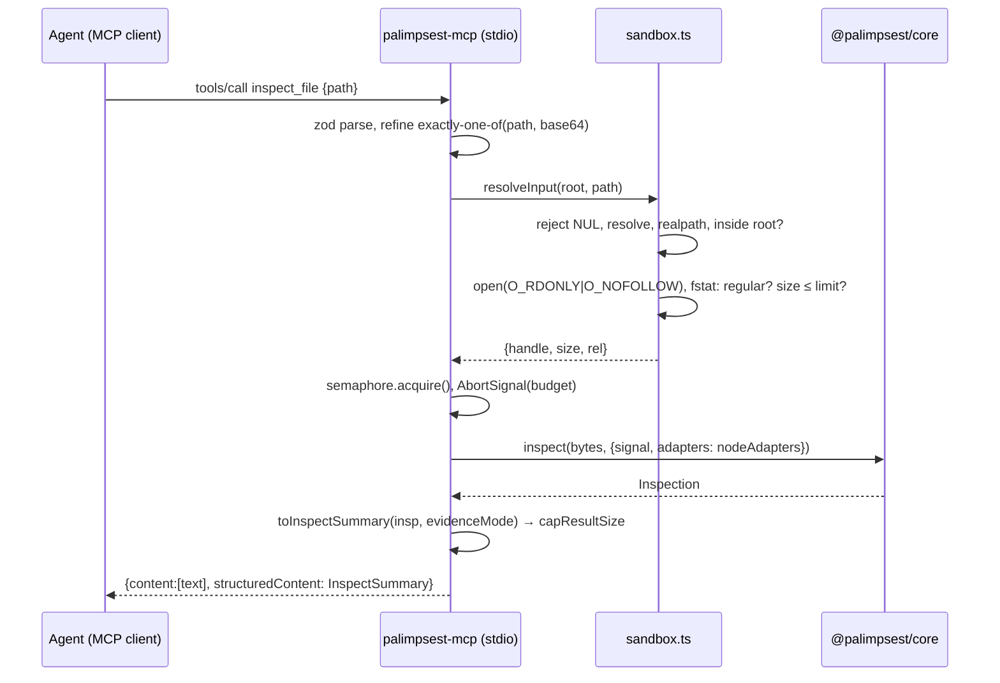
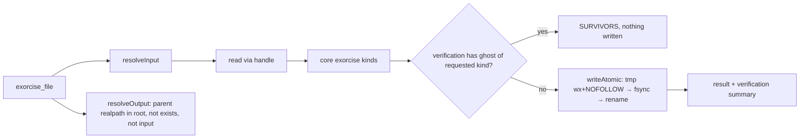

# Design Document

## Overview

`packages/mcp` is a thin, defensive shell around `packages/core`. It reads bytes from a sandboxed path (or inline base64), calls core `inspect` / `exorcise` in Node with injected Node image codecs, and turns the results into compact, size-bounded, redacted-by-default tool results. It never opens a socket.

`exorcist-power` packages that server for Kiro users with a steering file and hooks so agents scrub attachments before they leave the machine. The Palimpsest repo itself registers the server from source in `.kiro/settings/mcp.json`, so Kiro calls `inspect_file` during development (dogfooding).

Design decisions:

- **Redacted by default.** A tool result enters the agent's context, which is normally sent to a hosted model. Returning "GPS 51.5033, -0.1196" would move the very data Palimpsest exists to protect off the device. The agent only needs kind, severity and location type to decide and to explain; `--evidence full` is an explicit opt-in for local models or synthetic fixtures.
- **Refuse rather than write a half-clean file.** `exorcise_file` writes nothing when verification finds a survivor of a requested kind (G3 enforced at the boundary, not just in tests).
- **Sandbox by handle, not by name.** Check `realpath`, then open once and `fstat` the handle, read only from it. This closes the check-then-use window that name-based checks leave open.
- **Shared helpers live in core.** Node adapters, the ghost-kind catalogue and `redactGhost` are used by both this server and the Crew bot; putting them in core keeps a single redaction rule.

## Architecture

### Files

```
packages/core/src/
  node.ts                   nodeAdapters (subpath export "@palimpsest/core/node"), pngjs + jpeg-js
  ghost-kinds.ts            GHOST_KIND_INFO: Record<GhostKind, GhostKindInfo>
  redact.ts                 redactGhost(), redactedCounts()
packages/mcp/
  package.json              bin palimpsest-mcp, exports, files
  src/
    cli.ts                  argv parsing (node:util parseArgs) → ServerConfig, start
    server.ts               createServer(config): McpServer with tools + resource
    config.ts               ServerConfig zod schema
    sandbox.ts              resolveInput(), resolveOutput(), readWithin(), writeAtomic()
    limits.ts               budgetMs(), Semaphore(2), capResultSize()
    summarize.ts            toInspectSummary(), toText()
    errors.ts               ToolErrorCode, toolError(), ToolFailure
    tools/inspect-file.ts   input schema + handler
    tools/exorcise-file.ts  input schema + handler
    resources/ghost-kinds.ts
  test/no-network.setup.ts  socket/dns/fetch tripwires
  power/exorcist-power/
    POWER.md                manifest (frontmatter) + usage   ← verify against current Kiro Powers docs
    mcp.json                server config for the power
    steering/scrub-attachments.md
    hooks/inspect-new-attachment.kiro.hook   ← verify against current Kiro hooks docs
    hooks/scrub-staged-attachments.kiro.hook
.kiro/settings/mcp.json     dogfooding registration
```

### Request flow





## Components and Interfaces

### MCP SDK usage

Uses `McpServer` (`@modelcontextprotocol/sdk/server/mcp.js`) and `StdioServerTransport` (`@modelcontextprotocol/sdk/server/stdio.js`), with `registerTool(name, { title, description, inputSchema, outputSchema }, handler)` and `registerResource(name, uri, metadata, handler)`. Pin the SDK to an exact 1.x version in `package.json`; if the registration API names differ in the pinned version, only `server.ts` changes.

The SDK's `inputSchema` is a zod raw shape (no cross-field refinements), so each handler re-parses its arguments with the full schema (including `.superRefine` for exactly-one-of) before doing any work.

### Configuration

```ts
export interface ServerConfig {
  root: string;                         // canonical (realpath) absolute path
  maxBytes: number;                     // 1..209_715_200, default 52_428_800
  readOnly: boolean;                    // true → exorcise_file not registered
  evidence: 'redacted' | 'full';        // default 'redacted'
}
export const serverConfigSchema: z.ZodType<ServerConfig>;
export function parseCli(argv: readonly string[]): ServerConfig | { error: string };  // exit 2 on error
export function createServer(config: ServerConfig): McpServer;
```

### Tool input schemas

```ts
export const inspectFileInput = z.object({
  path: z.string().min(1).max(4096).optional(),
  base64: z.string().min(1).optional(),
  max_bytes: z.number().int().min(1).optional(),
}).strict();                                    // + superRefine: exactly one of path/base64; max_bytes ≤ config.maxBytes

export const ghostKindSchema: z.ZodType<GhostKind>;  // z.enum over every GhostKind; compile-time exhaustiveness check
export const exorciseFileInput = z.object({
  path: z.string().min(1).max(4096),
  out_path: z.string().min(1).max(4096).optional(),
  kinds: z.array(ghostKindSchema).min(1).max(20).optional(),   // de-duplicated after parse
}).strict();
```

### Sandbox (`sandbox.ts`)

```ts
export interface OpenedInput { handle: fs.promises.FileHandle; size: number; rel: string; real: string }
export function resolveInput(root: string, p: string, limit: number): Promise<OpenedInput>;     // throws ToolFailure
export function readAll(input: OpenedInput, signal: AbortSignal): Promise<Uint8Array>;        // reads exactly size bytes from the handle
export interface ResolvedOutput { real: string; rel: string }
export function resolveOutput(root: string, p: string, input: OpenedInput): Promise<ResolvedOutput>;
export function writeAtomic(out: ResolvedOutput, bytes: Uint8Array): Promise<void>;
export function isInside(root: string, candidate: string): boolean;   // pure; used by both resolvers
```

`isInside(root, c)`: with `r = path.relative(root, c)`, inside iff `r === ''`, or `r !== '..'` and `!r.startsWith('..' + path.sep)` and `!path.isAbsolute(r)` (so a file literally named `..foo` inside root is allowed, and a different Windows drive is outside). Input: `path.resolve(root, p)` → `fs.realpath` (ENOENT → `NOT_FOUND`) → `isInside` → `fs.open(real, O_RDONLY | O_NOFOLLOW?)` → `handle.stat()` regular file and `size ≤ limit`. Output: `path.resolve(root, p)`; `realpath(dirname)` must be inside; `lstat(final)` must be ENOENT (else `OUT_EXISTS`; a symlink also yields `OUT_EXISTS`); the resolved real output must differ from `input.real`. `writeAtomic` opens `<dir>/.<base>.<random>.tmp` with `'wx'` (+ `O_NOFOLLOW`), writes, `fsync`, closes, then `fs.link(tmp, final)` (fails if `final` appeared meanwhile, preserving "never overwrite") and `unlink(tmp)`; on platforms without hard links, falls back to `rename` after a final `lstat` check.

### Limits (`limits.ts`)

```ts
export function budgetMs(size: number): number;          // min(120_000, max(5_000, 2_000 * size / 1_048_576))
export class Semaphore { constructor(n: 2); run<T>(fn: () => Promise<T>): Promise<T> }   // FIFO
export function capResultSize<T extends { ghosts: SummaryGhost[] }>(s: T, maxBytes: 262_144): T & { truncated: boolean };
```

`capResultSize` drops ghosts from the end of the list sorted by `SEVERITY_ORDER` index descending (wisp first), then by id, until the serialized JSON fits.

### Summaries (`summarize.ts`)

```ts
export interface SummaryGhost {
  id: string; kind: GhostKind; severity: Severity; title: string; explanation: string;
  confidence: number; location: GhostLocation;
  evidence: { summary: string; fields?: Record<string, string> };   // never preview, never raw
}
export interface InspectSummary {
  checked: boolean;                       // false iff kind === 'unknown'
  kind: FileKind; size: number; durationMs: number;
  total: number;
  counts: Record<Severity, number>;       // every severity present
  ghosts: SummaryGhost[];
  warnings: Warning[];
  unchecked: GhostKind[];
  evidence: 'redacted' | 'full';
  truncated: boolean;
}
export function toInspectSummary(insp: Inspection, mode: 'redacted' | 'full'): InspectSummary;
export function toText(s: InspectSummary): string;

export interface ExorciseResult {
  out_path: string; kind: FileKind; bytes_in: number; bytes_out: number;
  banished: Exorcism['banished'];
  verification: InspectSummary;
  warnings: Warning[];
}
```

In `redacted` mode, for each ghost: `title = GHOST_KIND_INFO[kind].title`, `explanation = GHOST_KIND_INFO[kind].description`, `evidence = { summary: redactGhost(g).summary }`, and `location` is reduced to the fields `redactGhost` is allowed to read (type, byte length, page, revision index); `zip-entry.path`, `xpath` and `chunk.name` are dropped. In `full` mode, location is passed through and strings are truncated to 512 characters.

### Handlers

```ts
export function inspectFileHandler(cfg: ServerConfig, sem: Semaphore):
  (args: unknown) => Promise<CallToolResult>;
export function exorciseFileHandler(cfg: ServerConfig, sem: Semaphore):
  (args: unknown) => Promise<CallToolResult>;
export function ghostKindsResource(): { uri: 'palimpsest://ghost-kinds'; mimeType: 'application/json'; text: string };
```

`exorcise_file` survivor check: `requested = args.kinds ?? exorcistFor(kind).removes`; survivors = `verification.ghosts.filter(g => requested.includes(g.kind))`. `exorcistFor` comes from core's exorcist registry.

### Errors (`errors.ts`)

```ts
export type ToolErrorCode = 'INVALID_INPUT' | 'OUTSIDE_ROOT' | 'NOT_FOUND' | 'NOT_A_FILE' | 'TOO_LARGE'
  | 'TIMEOUT' | 'UNSUPPORTED_KIND' | 'OUT_EXISTS' | 'SURVIVORS' | 'INTERNAL';
export class ToolFailure extends Error { constructor(public code: ToolErrorCode, message: string, public detail?: unknown) }
export function toolError(f: ToolFailure): CallToolResult;  // isError: true, text "<CODE>: <message>", structuredContent.error
```

### Shared core helpers

```ts
// packages/core/src/node.ts   (package.json "exports": { "./node": "./dist/node.js" })
export const nodeAdapters: PlatformAdapters;   // decode/encode PNG (pngjs) and JPEG (jpeg-js, quality 92)

// packages/core/src/ghost-kinds.ts
export interface GhostKindInfo { title: string; description: string; typicalSeverity: Severity }
export const GHOST_KIND_INFO: Record<GhostKind, GhostKindInfo>;

// packages/core/src/redact.ts
export function redactGhost(g: Ghost): RedactedGhost;                 // RedactedGhost: proposed in types.ts
export function redactedCounts(gs: readonly Ghost[]): Record<Severity, number>;
```

`redactGhost.summary` is a fixed phrase per kind from a `Record<GhostKind, (ctx) => string>` table, with only numbers from allowed fields interpolated, for example: `gps-location` → "GPS location present"; `trailing-data` → "118,402 bytes of hidden data after the image end"; `unredacted-text` → "Live text under a redaction box on page 2"; `author-identity` → "Author name present"; `prior-revision` → "Earlier revision 1 kept by incremental save".

### Resource payload

```ts
interface GhostKindsDoc { version: 1; kinds: { kind: GhostKind; title: string; description: string;
  typicalSeverity: Severity; detectedIn: FileKind[]; removedFrom: FileKind[] }[] }
```

### Kiro Power: `exorcist-power`

All field names in this section are **verify against current Kiro Powers docs**; the content is fixed, the key spelling may change.

- **Manifest (`POWER.md` frontmatter):** `name: exorcist-power`, `displayName: Exorcist`, `description: "Find and remove hidden data (GPS, cropped-away pixels, live text under redactions, tracked changes) from files before an agent uploads or commits them."`, `keywords: [attachment, upload, screenshot, exif, metadata, redact, pdf, docx, scrub]`, `author`, `license: MIT`, `version` (equals `@palimpsest/mcp` version). The Markdown body explains the two tools, the redaction default and how to opt into `--evidence full`.
- **`mcp.json`:**
  ```json
  { "mcpServers": { "palimpsest": {
      "command": "npx",
      "args": ["-y", "@palimpsest/mcp@<exact version>", "--root", "${workspaceFolder}", "--evidence", "redacted"],
      "autoApprove": ["inspect_file"] } } }
  ```
  `${workspaceFolder}` expansion is **verify against current Kiro docs**; if unsupported, use `"--root", "."` and rely on the server being started with the workspace as its working directory (also to verify).
- **Steering (`steering/scrub-attachments.md`):** inclusion always (front matter `inclusion: always`, the same convention as this repo's steering). Content per Requirement 12, written as short imperative rules with one worked example ("User: attach screenshot.png to the issue" → `inspect_file` → "2 ghosts: GPS location present (wraith), device identity present (shade). Exorcise first?").
- **Hooks:** `inspect-new-attachment` — trigger file created, patterns per Requirement 13.1, action "ask agent" with the prompt "A new <file> appeared. Call inspect_file on it and report counts by severity in one line. Do not quote evidence values." `scrub-staged-attachments` — manual trigger; prompt instructs running `git diff --cached --name-only`, filtering by extension, inspecting each and summarizing in a table of path, kinds, highest severity.

### Dogfooding (`.kiro/settings/mcp.json`)

```json
{ "mcpServers": { "palimpsest": {
    "command": "npx",
    "args": ["tsx", "packages/mcp/src/cli.ts", "--root", ".", "--read-only", "--evidence", "full"],
    "disabled": false,
    "autoApprove": ["inspect_file"] } } }
```

`--evidence full` is acceptable here because the repository holds only generated, synthetic fixtures (enforced by the `haunted-asset-guard` hook); `--read-only` keeps Kiro from writing exorcised copies into the tree during development. `tsx` is a root devDependency so no build step is needed.

## Data Models

### Proposed change to types.ts

Add the redacted ghost shape, because both the MCP tool results and the Crew issue bodies are built from it and `types.ts` is the declared source of truth for "every MCP tool and Crew report":

```ts
/** A ghost described without any of its values. Safe to put in agent context, issues and logs. */
export interface RedactedGhost {
  id: string;
  kind: GhostKind;
  severity: Severity;
  confidence: number;
  /** Fixed phrase per kind with only non-identifying numbers, e.g. "GPS location present". */
  summary: string;
  /** Coarse place in the file: "PNG chunk", "byte range (118,402 bytes)", "PDF page 2", "DOCX part". */
  where: string;
}
```

No other `types.ts` change. `InspectSummary`, `SummaryGhost`, `ExorciseResult` and `GhostKindsDoc` are MCP wire formats derived from `Inspection`, `Ghost` and `Exorcism`, defined in `packages/mcp/src/summarize.ts`.

## Error Handling

| Condition | Code | Notes |
|---|---|---|
| zod failure, both/neither of path and base64, bad base64, `max_bytes` > server limit, NUL in path | `INVALID_INPUT` | message lists the failing field names only |
| resolved path outside root | `OUTSIDE_ROOT` | message shows the argument as given, never the resolved target |
| ENOENT | `NOT_FOUND` | |
| directory, FIFO, device, socket | `NOT_A_FILE` | |
| size or base64 length over limit | `TOO_LARGE` | checked before read/decode |
| AbortSignal fired | `TIMEOUT` | partial warnings included |
| `kind: 'unknown'` or no exorcist | `UNSUPPORTED_KIND` | `inspect_file` never returns this; it returns `checked: false` |
| output exists or is a symlink | `OUT_EXISTS` | |
| verification survivors | `SURVIVORS` | survivors in `detail`, summarized per evidence mode |
| anything else | `INTERNAL` | stack to stderr only |

Process-level: uncaught exceptions and unhandled rejections are logged to stderr and the process keeps serving; a failure to bind stdio exits 1.

## Correctness Properties

1. **P1 Sandbox soundness.** For any relative or absolute path string (including `..` segments, symlinks created in a temp root pointing inside and outside), `resolveInput` succeeds only if the realpath is inside root; `isInside` agrees with a reference implementation built on path segments.
2. **P2 No overwrite.** For any existing file at `out_path` (or a symlink there), `exorcise_file` returns `OUT_EXISTS` and the existing file's bytes are unchanged.
3. **P3 Input untouched (G2).** After `exorcise_file`, the input file's bytes and mtime are unchanged.
4. **P4 No survivors written (G3 at the boundary).** If verification contains a requested kind, no file exists at `out_path` and no temp file remains.
5. **P5 Redaction.** In `redacted` mode, for ghosts with random marker strings in every string field, no marker appears in the serialized tool result; `redactGhost` has the same property (Requirement 10.4).
6. **P6 Counts.** `counts` has all four severities, values sum to `total`, and `total === ghosts.length` (before truncation; `truncated` set otherwise).
7. **P7 Size cap.** For any inspection, the serialized result is ≤ 256 KB, and truncation never drops a ghost while a lower-severity one is kept.
8. **P8 No network.** With socket, DNS and fetch tripwires installed, every tool and the resource complete without tripping.
9. **P9 Catalogue completeness.** `GHOST_KIND_INFO` and the resource list every `GhostKind` exactly once; `detectedIn`/`removedFrom` match the registries.
10. **P10 Power config consistency.** The power's `mcp.json` pins the same version as `packages/mcp/package.json` and auto-approves only registered tool names.

## Testing Strategy

- **Unit (vitest):** `parseCli` table tests (missing root, bad numbers, flags); `isInside` and resolvers on a temp directory tree with symlinks, FIFOs (skipped on Windows) and `..foo` names (P1, P2); `budgetMs`; `Semaphore` FIFO order; `toInspectSummary` and `toText` snapshots on synthetic `Inspection` objects built from `types.ts`; `capResultSize` (P7); `redactGhost` property test with `fast-check` (P5); error mapping.
- **Integration:** spawn the built server with `StdioClientTransport` from the SDK against a temp root containing Haunted Gallery fixtures; call `tools/list`, `inspect_file` (path and base64), `exorcise_file` (default out path, explicit out path, `kinds` subset, existing out path), and `resources/read palimpsest://ghost-kinds`; assert P3, P4, P6, P9, and that stdout contains only valid JSON-RPC frames.
- **No network (P8):** a vitest setup file installs tripwires on `net.Socket.prototype.connect`, `tls.connect`, `dns.lookup`, `dns.promises.lookup` and `globalThis.fetch`; the integration suite runs in-process with it. `scripts/check-no-network.ts` covers `packages/mcp/src` with Node module names.
- **Power (P10):** a test parses `power/exorcist-power/mcp.json`, the hook files and the `POWER.md` frontmatter with zod, compares versions, and checks tool names against `createServer(...)`'s registered tools.
- **Dogfooding smoke:** a test parses `.kiro/settings/mcp.json` and runs the same command line for 2 s with an `initialize` request to make sure it starts from source.
