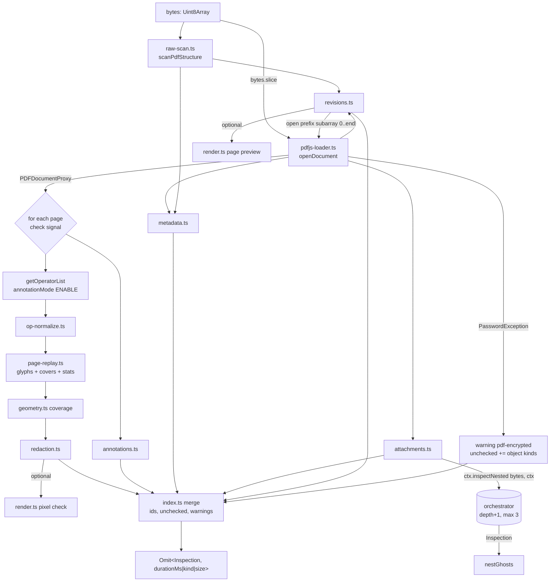

# Design Document

## Overview

The PDF extractor runs two passes over the same immutable input:

1. **Raw pass** (`raw-scan.ts`, pure, no dependencies): walks the bytes once to find `%%EOF` boundaries, `startxref` offsets, the `/Prev` chain, linearization, `/Encrypt` and uncompressed XMP packets. It never fails. If pdf.js cannot open the file, this pass still reports prior revisions (G6).
2. **Object pass** (pdf.js 6.5.438, lazy): loads a copy of the bytes, then runs one detector per ghost kind. The redaction detector replays each page's operator list with a small graphics-state machine to get glyph boxes and covers in paint order, then computes coverage geometrically.

Every detector returns `Partial<DetectorResult>`. `index.ts` merges the results, numbers ghost ids per kind, and fills `unchecked` from detectors that were skipped, aborted or failed.

The extractor reports evidence. It does not draw anything itself. The reveal layer gets:
- `unredacted-text`: page plus rectangle plus hidden text. The web app draws the text in mono under the bar on the vellum, so no preview bytes are needed.
- `prior-revision`: a rendered PNG of the first differing page from the older revision.
- `embedded-file`: the attachment itself when it is a small PNG or JPEG.

## Architecture

### Files

```
packages/core/src/extractors/pdf/
  index.ts                 export const extractor: Extractor; orchestration, id numbering, unchecked
  pdfjs-loader.ts          setPdfjsLoader(), loadPdfjs(), openDocument() with safe options
  raw-scan.ts              scanPdfStructure(bytes) -> RawPdfStructure
  op-normalize.ts          version-specific operator-list shapes -> NormalizedOp stream
  page-replay.ts           graphics/text state machine -> { glyphs, covers, stats }
  geometry.ts              quads, AABBs, rect union area, coverage
  redaction.ts             detectUnredactedText(page, ...) -> Ghost drafts
  revisions.ts             detectPriorRevisions(raw, doc, ...) -> Ghost drafts
  metadata.ts              detectMetadata(doc, raw) -> Ghost drafts (pdf-metadata, author-identity, software-trail, capture-time)
  annotations.ts           detectHiddenAnnotations(doc) -> Ghost drafts
  attachments.ts           detectEmbeddedFiles(doc, ctx) -> embedded-file drafts + nestGhosts(...) drafts
  render.ts                previews and pixel checks via PlatformAdapters.rasterizePdfPage (proposed) + encodeImage
  pdf-dates.ts             "D:YYYYMMDDHHmmSSOHH'mm'" -> ISO 8601
  *.test.ts, pdf.prop.test.ts
packages/core/src/extractors/shared/
  pii-patterns.ts          email/phone/id/address matchers (shared with docx)
  image-dimensions.ts      PNG IHDR / JPEG SOFn width+height without decoding
```

### Data flow



### Lifecycle and budget

- `index.ts` creates one `PDFDocumentProxy` for the final revision, and at most one more at a time for prior prefixes. Each is `destroy()`ed in a `finally`.
- `ctx.signal` is checked before each page, between detectors, and every 5,000 operators in `page-replay.ts`. On abort, pending detectors are marked unchecked and `loadingTask.destroy()` is called.
- pdf.js runs its own worker. In Node it uses its built-in fake worker. In the browser, the host's loader sets `GlobalWorkerOptions.workerSrc` to the same-origin URL of `pdf.worker.min.mjs` emitted by Vite (nested workers are allowed inside `apps/web/src/worker.ts`). Core never references a URL.

## Components and Interfaces

```ts
// pdfjs-loader.ts
import type * as Pdfjs from 'pdfjs-dist';
export type PdfjsModule = typeof Pdfjs;
export type PdfjsLoader = () => Promise<PdfjsModule>;
export function setPdfjsLoader(loader: PdfjsLoader): void;          // host override (web sets workerSrc)
export function loadPdfjs(): Promise<PdfjsModule>;                   // memoized dynamic import('pdfjs-dist/legacy/build/pdf.mjs')
export type OpenResult =
  | { ok: true; doc: Pdfjs.PDFDocumentProxy; destroy(): Promise<void>; warnings: Warning[] }
  | { ok: false; reason: 'password' | 'parse'; message: string; warnings: Warning[] };
export function openDocument(bytes: Uint8Array, signal?: AbortSignal): Promise<OpenResult>; // always copies bytes

// raw-scan.ts
export interface RevisionBoundary {
  eofOffset: number;          // offset of '%' in %%EOF
  end: number;                // boundary: after marker + EOL
  startxref: number | null;   // value parsed before the marker
  xrefKind: 'table' | 'stream' | 'invalid';
  confirmed: boolean;         // on the /Prev chain from the final startxref
  linearizedFirstPage: boolean;
}
export interface RawPdfStructure {
  headerOffset: number | null;
  version: string | null;
  boundaries: RevisionBoundary[];   // only accepted boundaries, ascending
  encrypted: boolean;
  linearized: boolean;
  xmpPackets: { start: number; end: number }[];
  objectIndex: Map<string, { start: number; end: number }>; // "num gen" -> byte range of "N G obj ... endobj", best effort, last definition wins
  trailerRanges: { start: number; end: number }[];
  warnings: Warning[];
}
export function scanPdfStructure(bytes: Uint8Array, signal?: AbortSignal): RawPdfStructure;

// op-normalize.ts — isolates pdf.js version-specific argument shapes
export type NormalizedOp =
  | { op: 'save' | 'restore' | 'beginText' | 'endText' | 'nextLine' }
  | { op: 'transform'; m: Matrix }
  | { op: 'formBegin'; m: Matrix; bbox: Rect | null } | { op: 'formEnd' }
  | { op: 'gstate'; fillAlpha?: number; softMask?: boolean; blendMode?: string; font?: [string, number] }
  | { op: 'fillColor'; rgb: [number, number, number] | null }            // null = pattern/unknown
  | { op: 'font'; loadedName: string; size: number }
  | { op: 'textParam'; key: 'charSpacing' | 'wordSpacing' | 'hScale' | 'leading' | 'rise' | 'renderMode'; value: number }
  | { op: 'textMatrix'; m: Matrix } | { op: 'moveText'; tx: number; ty: number; setLeading: boolean }
  | { op: 'showText'; items: ReadonlyArray<{ unicode: string; width: number; isSpace: boolean } | number> }
  | { op: 'path'; paint: 'fill' | 'stroke' | 'fillStroke' | 'none'; closedQuad: Quad | null; bbox: Rect }
  | { op: 'image'; } | { op: 'annotationBegin'; subtype?: string; rect: Rect } | { op: 'annotationEnd' }
  | { op: 'other' };
export type Matrix = readonly [number, number, number, number, number, number];
export type Quad = readonly [Point, Point, Point, Point];
export interface Point { x: number; y: number }
export function normalizeOps(list: { fnArray: number[]; argsArray: unknown[] }, OPS: Record<string, number>): Iterable<[index: number, op: NormalizedOp]>;

// page-replay.ts
export interface GlyphBox { opIndex: number; seq: number; unicode: string; quad: Quad; aabb: Rect; line: number; renderMode: number }
export interface Cover {
  opIndex: number;            // Infinity for unapplied Redact annotations
  source: 'rect' | 'image' | 'redact-annot';
  quad: Quad; aabb: Rect; axisAligned: boolean;
  rgb: [number, number, number] | null; alpha: number; opaque: boolean;
}
export interface ReplayStats { glyphCount: number; fillPathCount: number; imageArea: number; opCount: number; aborted: boolean }
export interface FontMetrics { fontMatrix: Matrix; ascent: number; descent: number; vertical: boolean }
export function replayPage(
  ops: Iterable<[number, NormalizedOp]>,
  fonts: (loadedName: string) => FontMetrics | null,
  signal?: AbortSignal,
): { glyphs: GlyphBox[]; covers: Cover[]; stats: ReplayStats; warnings: Warning[] };

// geometry.ts
export function applyMatrix(m: Matrix, p: Point): Point;
export function multiply(a: Matrix, b: Matrix): Matrix;
export function quadAabb(q: Quad): Rect;
export function isAxisAligned(q: Quad, epsilon?: number): boolean;
export function intersect(a: Rect, b: Rect): Rect | null;
export function unionArea(rects: readonly Rect[]): number;              // exact, coordinate-compression sweep
export function coverage(glyph: Rect, covers: readonly Rect[]): number; // unionArea(covers ∩ glyph) / area(glyph), in [0,1]
export function unionRect(rects: readonly Rect[]): Rect;

// redaction.ts
export interface RedactionSpan { page: number; text: string; rect: Rect; coverage: number; cover: Cover; glyphs: GlyphBox[] }
export function findHiddenSpans(page: number, glyphs: GlyphBox[], covers: Cover[], threshold?: number /*0.6*/): RedactionSpan[];
export function spanToGhostDraft(span: RedactionSpan, pixelCheck: 'uniform' | 'not-uniform' | 'skipped'): GhostDraft;

// revisions.ts
export function detectPriorRevisions(bytes: Uint8Array, raw: RawPdfStructure, final: PdfDocLike | null, env: DetectorEnv): Promise<DetectorResult>;

// metadata.ts / annotations.ts / attachments.ts
export function detectMetadata(doc: PdfDocLike, raw: RawPdfStructure, env: DetectorEnv): Promise<DetectorResult>;
export function detectHiddenAnnotations(doc: PdfDocLike, env: DetectorEnv): Promise<DetectorResult>;
export function detectEmbeddedFiles(doc: PdfDocLike, raw: RawPdfStructure, env: DetectorEnv): Promise<DetectorResult>;

// shared detector plumbing (index.ts)
export type GhostDraft = Omit<Ghost, 'id'>;
export interface DetectorResult { ghosts: GhostDraft[]; warnings: Warning[]; unchecked: GhostKind[] }
export interface DetectorEnv { ctx: ExtractContext; signal?: AbortSignal; bytes: Uint8Array /* never mutated */ }
export type PdfDocLike = Pick<import('pdfjs-dist').PDFDocumentProxy, 'numPages' | 'getPage' | 'getMetadata' | 'getAttachments' | 'getOptionalContentConfig'>;

// render.ts
export function renderPagePreview(pdf: Uint8Array, page: number, maxWidth: number, adapters: PlatformAdapters): Promise<GhostEvidence['preview'] | null>; // null if adapters missing
export function regionIsUniform(pdf: Uint8Array, page: number, rect: Rect, pageBox: Rect, adapters: PlatformAdapters): Promise<boolean | null>;
export function channelStdDev(rgba: Uint8ClampedArray, width: number, crop: { x: number; y: number; w: number; h: number }): [number, number, number];

// shared/pii-patterns.ts
export function matchesPii(text: string): { kind: 'email' | 'phone' | 'national-id' | 'street-address'; match: string } | null;
// shared/image-dimensions.ts
export function imageDimensions(bytes: Uint8Array): { mime: 'image/png' | 'image/jpeg'; width: number; height: number } | null;
```

### The redaction geometry algorithm

**1. Glyph boxes from the operator list.** pdf.js turns `Tj`, `TJ`, `'` and `"` into `showText` operators whose arguments are glyph objects (`unicode`, `width`, `isSpace`) with numbers mixed in for TJ kerning. `page-replay.ts` keeps the PDF text state and does what the canvas renderer does:

- Text rendering matrix: `Trm = [Tfs·Th, 0, 0, Tfs, 0, Trise] × Tm × CTM`.
- Glyph advance: `tx = (w0 · fontMatrix[0] · Tfs + Tc + (isSpace ? Tw : 0)) · Th`, where `w0` is `glyph.width` in glyph space. A TJ number `n` moves by `−n/1000 · Tfs · Th`.
- Glyph box in text space: `[0, descent·Tfs] .. [advance, ascent·Tfs]`, using the font's ascent and descent from `page.commonObjs`, or 0.8 and −0.2 if they are missing. Mapping its four corners through `Trm` gives a `Quad` in user space. For axis-aligned text the quad equals its AABB.
- Each glyph records the operator index of its `showText`, plus `seq` for its order inside the operator.

Reading glyphs from the operator list, rather than from `getTextContent()`, gives per-glyph geometry and paint order from one source. `getTextContent` merges and splits runs and cannot be lined up reliably with operator indices. It is used only as a fallback when replay fails (warning `pdf-replay-fallback`). In that case every cover on the page counts as later, and confidence is multiplied by 0.6.

**2. Covers.** In pdf.js 6.x a path arrives as one `constructPath` operator: `[paintOp, [Float32Array of DrawOPS], minMax]`, and a `re` becomes `moveTo, lineTo ×3, closePath`. `op-normalize.ts` decodes the buffer. A path is a quad cover candidate if it has exactly one subpath with four distinct corners (a trailing repeat of the first point is allowed) and the paint op fills. The quad is mapped through the CTM. Fill color comes from `setFillRGBColor` (hex string or byte triplet; both accepted) and `setFillGray`/`setFillCMYKColor`, converted to RGB. Alpha, soft mask and blend mode come from `setGState`. `save`/`restore` push and pop the whole state, and form XObjects push their `/Matrix`. Images (`paintImageXObject`, `paintInlineImageXObject`) become unit-square covers mapped through the CTM. Annotation appearances (`beginAnnotation`…`endAnnotation`) are replayed like content, because a filled `Square` annotation is a common bar. A `Redact` annotation's rect (or QuadPoints) becomes a cover with `opIndex = Infinity`.

**3. Coverage.** For each glyph `g`, collect the opaque covers with `opIndex > g.opIndex` whose AABB meets `g.aabb`. Clip each to `g.aabb` and compute the union area exactly with a coordinate-compression sweep (n is small, typically < 10). `coverage = unionArea / area(g.aabb)`. For rotated covers the quad's AABB is an over-estimate, so these get lower confidence (0.75). Glyphs with zero area (`Tfs = 0`, zero-width spaces) are skipped.

**4. Spans.** Hidden glyphs (coverage ≥ 0.60) are grouped by `line`, a counter that increases on every `Td`/`TD`/`Tm`/`T*` with a vertical move of more than 0.5·Tfs. Glyphs are joined into one span when they are consecutive in `(opIndex, seq)` order and their gap is < 1.5 × the mean advance. Whitespace-only spans are dropped. Each span becomes one ghost, using the strongest cover in the span for color, source and confidence.

**5. Optional pixel check.** With `rasterizePdfPage`, the page is rasterized at scale 2, and the cover's AABB is mapped from user space to pixel space through the page box (y flipped) and cropped. If the per-channel standard deviation inside the crop (inset by 1 px) is ≤ 8, the cover really hides what is under it: confidence becomes `max(confidence, 0.9)` and `fields['Visually hidden']` is `yes`. If not (text drawn on top, or a transparent bar), confidence becomes `min(confidence, 0.55)`, which the UI shows as "possible ghost". This is X-Ray's "is the box a single color" check.

**Limits (documented in the UI's "What we can't see"):**
- Clip paths are not tracked. A bar clipped away to nothing still counts. The pixel check catches this when the rasterizer is available.
- Soft masks, transparency groups and non-Normal blend modes make a cover non-opaque. This may miss a hidden glyph, but avoids a false alarm.
- Covers are limited to quads and images. Free-form black blobs (curves) are not covers.
- Text rendered as vector outlines, Type 3 glyphs without Unicode, and text in scanned images are not text to us (`pdf-outline-text-possible`, `pdf-scanned-page`).
- White text on white, tiny text and off-page text are hidden in other ways, and are out of scope for this kind.
- Glyph boxes use font ascent and descent, not real glyph outlines. The 0.60 threshold is chosen so a bar covering the x-height band of a line still counts.

### Prior-revision algorithm

1. `raw-scan` finds candidate `%%EOF`s with a single forward byte scan (a 5-byte matcher). For each one it searches backwards at most 1,024 bytes for `startxref`, parses the offset, and checks the target (`xref` keyword, or `N G obj` with `/Type /XRef` within 256 bytes).
2. Linearized files: if the first object dictionary (within the first 1,024 bytes) has `/Linearized`, the first accepted boundary whose `startxref` points at the first-page xref is flagged `linearizedFirstPage` and dropped.
3. `/Prev` chain: from the final `startxref`, parse the trailer (classic) or xref stream dictionary, read `/Prev`, and repeat. The loop is bounded (1,024 steps, visited set). Boundaries whose `startxref` is on the chain are `confirmed`. A `%%EOF` inside an embedded PDF attachment normally fails the chain check, so it gets confidence 0.7, and it is not dropped, because G6 prefers a possible ghost to a silent miss.
4. For each prior boundary (oldest first, up to 32), `openDocument(bytes.subarray(0, end))` (copied inside). Pages are compared to the final revision in order: count, then `normalizeText(getTextContent)` (whitespace collapsed), then an FNV-1a hash over `fnArray`. The first page that differs is rendered for the preview. `Text removed since` is the multiset difference of whitespace-separated tokens (prior minus final), joined and cut to 500 characters.
5. Classification by the objects the *next* update redefines (from its xref section): content streams or page objects mean `wraith`; only Info, Metadata, Annots or AcroForm mean `shade`; only a signature field with `/ByteRange` means `wisp`.

### Metadata, annotations and attachments

- `doc.getMetadata()` gives `info` (including `Custom`) and `metadata` (pdf.js's own parsed XMP). Dates go through `pdf-dates.ts`. Stray XMP packets come from `raw.xmpPackets` minus the range of the catalog `/Metadata` stream. Packets inside compressed streams are invisible to the raw scan, which is a documented limit.
- `page.getAnnotations({ intent: 'any' })` gives `annotationFlags`, `subtype`, `rect`, `contentsObj.str`, `titleObj.str`, `modificationDate`, `inReplyTo` and `file` (for FileAttachment).
- `doc.getAttachments()` gives `{ filename, content, description }`. Duplicates between the name tree and the annotations are removed using `${filename}:${fnv1a(content)}`.
- Each attachment of at most 64 MB is passed to `ctx.inspectNested(content, ctx)` (the same `ctx`; the orchestrator adds 1 to the depth and refuses depth 4 with `max-depth`). The inner ghosts become `nestGhosts(inner, embeddedFileGhost.location)`. Nested warnings and the `embedded-media-ghost` unchecked flag come from the orchestrator (ghost-model Requirement 7.5), so this extractor does not repeat them.

## Data Models

Ghosts follow `types.ts` exactly. Field labels per kind (stable, because the Paw matches on values, not labels):

| Kind | Location | Fields | Severity | Confidence |
|---|---|---|---|---|
| `unredacted-text` | `pdf-region` (1-based page) | Text, Page, Cover color, Cover source, Coverage, Visually hidden | revenant if PII else wraith | 0.5–0.99 (Req 4.8) |
| `prior-revision` | `pdf-revision` | Revision, Bytes, Pages then, Pages now, First differing page, Text removed since, Changed objects | wraith / shade / wisp | 0.95 / 0.7 / 0.6 |
| `pdf-metadata` | `byte-range` | every Info key or XMP property | shade / wisp | 1.0 |
| `author-identity` | `byte-range` (same as source) | Name, Source (`Info /Author` or `XMP dc:creator`) | wraith | 0.95 |
| `software-trail` | `byte-range` (same as source) | Creator, Producer, CreatorTool, History | wisp | 1.0 |
| `capture-time` | `byte-range` (same as source) | Created, Modified, Metadata date | wisp | 1.0 |
| `embedded-media-ghost` | `nested` (container = the `embedded-file` location) | inner fields | inner | inner |
| `hidden-annotation` | `pdf-region` | Subtype, Flags, Author, Contents, Modified, In reply to | wraith / shade | 1.0 |
| `embedded-file` | `pdf-region` or `byte-range` | File name, Size, Description, Detected format, Ghosts inside | wraith | 1.0 |

`evidence.raw` carries structured data for the MCP and Crew outputs: `RedactionSpan` minus glyph arrays, `RevisionBoundary`, and the parsed Info object.

## Proposed change to types.ts

Previews and the redaction pixel check need a PDF rasterizer. Core must not touch the DOM, and `PlatformAdapters` has only `decodeImage` and `encodeImage`. The exorcism spec already proposes `PlatformAdapters.rasterizePdfPage` for `rasterizeRedactions` (see the ghost-model spec's note). This spec uses **the same member**, and needs only this shape:

```ts
export interface PlatformAdapters {
  // ...existing members unchanged
  /** Render 1-based `page` of `pdf` to RGBA. Browser/worker: pdf.js + OffscreenCanvas. Node: optional. */
  rasterizePdfPage?(pdf: Uint8Array, page: number, opts: { scale: number }): Promise<{ width: number; height: number; rgba: Uint8ClampedArray }>;
}
```

If the exorcism spec settles on a different signature, `render.ts` adapts to it. The only things this spec relies on are "page N of these bytes to RGBA at a given scale" and that the adapter must not mutate `pdf`, so the extractor passes a copy. Without the adapter, previews and pixel checks are skipped with `preview-unavailable` (Requirement 9.6), and every other check runs unchanged.

## Error Handling

| Condition | Behaviour | Warning code | `unchecked` |
|---|---|---|---|
| No `%PDF-` header in first 1 KB | continue (pdf.js tolerates leading junk) | `pdf-no-header` | — |
| Password required | raw-scan results only | `pdf-encrypted` | all object-pass kinds |
| Encrypted, empty user password works | full checks | `pdf-encrypted-owner-only` | — |
| pdf.js load error | raw-scan results only | `pdf-parse-failed` | all object-pass kinds |
| Page load or operator list error | skip page | `pdf-page-failed` (offset unset, message has page) | kinds of that detector |
| Replay throws (bug guard) | fall back to `getTextContent` | `pdf-replay-fallback` | — |
| Scanned page | — | `pdf-scanned-page` | `unredacted-text` |
| Outline text suspected | — | `pdf-outline-text-possible` | `unredacted-text` |
| Missing Unicode | glyphs shown as U+FFFD | `pdf-no-unicode` | — |
| Prior prefix won't open | ghost without preview | `pdf-revision-unreadable` (offset = boundary) | — |
| > 32 prior revisions | ghosts without comparison | `pdf-revisions-truncated` | — |
| Page/op limits | stop page loop | `pdf-limit-reached` | `unredacted-text` |
| Abort | destroy loading task, return partial | `budget-exceeded` | unfinished kinds |
| No `rasterizePdfPage` (or no `encodeImage` for previews) | no previews or pixel check | `preview-unavailable` | — |
| CMap or standard font missing | continue | `pdf-font-data-missing` | — |
| Hidden OCG layers | — | `pdf-hidden-layer` | — |

Every detector runs inside `try/catch` in `index.ts`. A thrown error becomes `pdf-detector-failed` plus that detector's kinds in `unchecked`. `extract` itself has a final catch-all that returns `{ ghosts: [], warnings: [...], unchecked: detects }`.

## Correctness Properties

Each property is one `fc.assert(fc.property|asyncProperty(...))` in `pdf.prop.test.ts` or `geometry.prop.test.ts`. PDF inputs come from the Paw's `PdfRecipe` arbitrary and builder (`paw/gen/pdf-writer.ts` and `paw/arbitraries.ts`, the-paw tasks 3 and 5).

1. **Coverage bounds.** For any glyph rect with positive area and any cover rects, `0 ≤ coverage(g, covers) ≤ 1`, and `coverage(g, [g]) === 1`.
2. **Coverage monotonicity.** For any glyph and covers `C ⊆ C'`, `coverage(g, C) ≤ coverage(g, C')`.
3. **Union area is exact.** For any rects, `max(area_i) ≤ unionArea(rects) ≤ Σ area_i`, and for pairwise-disjoint rects `unionArea === Σ area_i` (within 1e-9 relative).
4. **Matrix replay matches the canvas maths.** For any text state and glyph widths, the glyph origins `page-replay` computes equal the reference formula `Trm × advance` within 1e-6 user units.
5. **Later opaque cover detects.** For any PDF recipe with a text line and an opaque rectangle drawn *after* it covering the line's padded box (descent − 0.1·Tfs to ascent + 0.1·Tfs), `extract` reports an `unredacted-text` ghost on that page whose `Text` field contains the line's text, with confidence ≥ 0.85.
6. **No ghost from earlier or translucent covers.** For any recipe where the rectangle is drawn *before* the text, or has `ca < 0.95`, or covers ≤ 40% of the glyph height, `extract` reports no `unredacted-text` ghost for that line.
7. **Threshold edge.** For any recipe whose cover spans a fraction `f` of every glyph box height (with full width), the line is reported if `f ≥ 0.65` and not reported if `f ≤ 0.55`. The 0.05 margin either side absorbs float error.
8. **Revision count.** For any recipe with `k ≥ 0` incremental updates (classic or xref-stream style), `scanPdfStructure` returns `k + 1` boundaries, all `confirmed`, and `extract` returns exactly `k` `prior-revision` ghosts with indices `0..k−1` and contiguous, non-overlapping `[start, end)` ranges.
9. **Prefix validity.** For any recipe with updates, every prior-revision ghost's `bytes.subarray(0, end)` opens in pdf.js without a password or parse error.
10. **Linearization is not a revision.** For any linearized-style recipe with no updates, `extract` returns zero `prior-revision` ghosts.
11. **Metadata round-trip.** For any Info dictionary and XMP recipe built from synthetic tokens, every non-empty planted value appears in some `pdf-metadata` ghost's fields, and a planted `/Author` or `dc:creator` yields an `author-identity` ghost with that name.
12. **Annotation flags.** For any annotation recipe with flags `F` and optional `/T` and `/Contents`, a `hidden-annotation` ghost is reported if and only if Requirement 7.1's predicate holds for `F`, subtype, `/T` and `/Contents`.
13. **Attachments.** For any set of attachments with distinct names, the number of `embedded-file` ghosts equals the number of attachments, every name appears in a `File name` field, and for each attachment that is a PNG/JPEG curse, every planted inner ghost appears as an `embedded-media-ghost` whose `nested.container` equals that `embedded-file` ghost's location.
14. **Raw scanner never throws, and runs in linear time.** For any `Uint8Array` up to 1 MB (arbitrary, or a valid recipe with byte mutations), `scanPdfStructure` returns, every reported range lies within `[0, length]`, and the number of steps taken is ≤ 8 × length + a constant (measured with an injected step counter).
15. **Extractor never throws, and never mutates.** For any arbitrary or mutated input, `extract` resolves, its output passes `ExtractResultSchema` (from `schema.ts`, ghost-model spec), and the input bytes and `byteLength` are unchanged afterwards.

## Testing Strategy

- **Unit tests (vitest), one per module:** `pdf-dates.test.ts` (offsets, partial dates, garbage), `raw-scan.test.ts` (hand-written byte strings for CRLF and CR `%%EOF`, `%%EOF` inside streams, broken startxref, `/Prev` loops, linearized header), `op-normalize.test.ts`, `geometry.test.ts`, `page-replay.test.ts` (TJ kerning, `Tz`, `Ts`, rotation, nested `q`/`Q`, form matrices).
- **Shape-lock test:** `op-normalize.shape.test.ts` loads a fixed generated PDF through the pinned pdf.js and asserts the exact `constructPath` and `setFillRGBColor` argument shapes. A pdf.js upgrade that changes them fails here, not silently in the detector.
- **Property tests:** properties 1–15 above, `FC_NUM_RUNS` per the-paw's CI config, run through `npm run test:paw`.
- **Fixtures:** `scripts/make-fixtures.ts` builds the Haunted Gallery PDFs (`redacted-memo.pdf` with synthetic names "Ada Quill" and "Corwin Vale", `three-revisions.pdf`, `attachments.pdf`) from fixed Paw recipes, so the demo and the snapshot tests share the same inputs.
- **Snapshot tests:** the ghost list for each gallery PDF, with `preview.bytes` replaced by their SHA-256.
- **Bundle test:** the web build's initial chunk does not contain the string `pdfjs-dist`. This is checked in `apps/web` CI by `scripts/check-no-network.ts`'s bundle step.
- **No-network:** covered by the Playwright G1 test running every gallery PDF.
