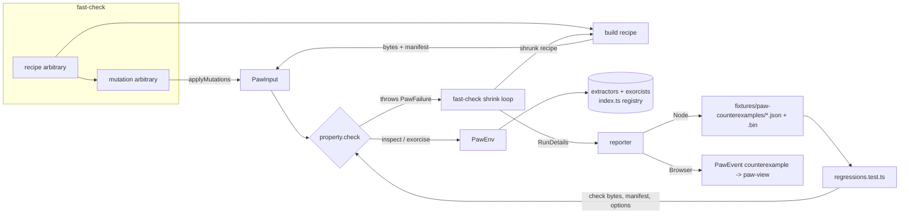
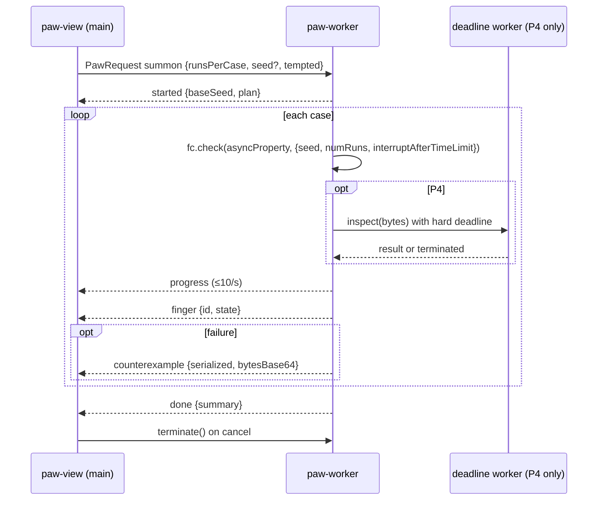

# Design Document

## Overview

The Paw has four layers. Each depends only on the layers below it:

1. **Writers** (`paw/gen/*`): pure byte writers for PNG, JPEG, EXIF/TIFF, XMP, ICC, PDF, ZIP and DOCX. No randomness, no I/O.
2. **Recipes and builders** (`paw/recipes.ts`, `paw/build.ts`): JSON-serialisable recipes, and `build(recipe)`, which returns bytes plus a manifest of planted ghosts. The builder is the only code that knows *where* a ghost ends up, so it writes the manifest as it writes the bytes.
3. **Arbitraries** (`paw/arbitraries.ts`, `paw/mutations.ts`): fast-check arbitraries over recipes and mutations, designed to shrink well.
4. **Properties and runner** (`paw/properties.ts`, `paw/runner.ts`): each property is a plain async `check(input, env)` that throws `PawFailure` with structured detail. Arbitraries are attached to checks separately, so the same check can run under fast-check, against a stored counterexample (regression) or on a replay in the app.

`PawEnv` hides how inspection and exorcism are reached: the Node test registry, the browser worker registry, or the tempted registry in the demo. The same properties therefore run in vitest, CI and the browser.

## Architecture

### Files

```
packages/core/src/
  paw/
    bytes.ts                    ByteWriter, crc32, adler32, fnv1a32, base64, sha256 (crypto.subtle)
    synthetic.ts                synthetic names, orgs, landmarks (lat/lon), software strings; token suffixes
    gen/
      deflate.ts                zlibStore(), deflateStoredRaw(), deflateFixedLiteralRaw()
      png-writer.ts             writePng(), aCropalypse tail composition
      jpeg-writer.ts            DC-only baseline encoder, segment injection
      tiff-writer.ts            EXIF TIFF (II/MM), IFD0/Exif/GPS/IFD1
      xmp-writer.ts             x:xmpmeta packets
      icc-writer.ts             minimal ICC v2 profile with desc/cprt
      pdf-writer.ts             object model, xref table/stream, incremental updates, Helvetica metrics, encrypt stubs
      md5-rc4.ts                for owner-only encryption (Algorithm 2/3/4, R2, 40-bit)
      zip-writer.ts             store/fixed-deflate, Zip64, hostile options
      docx-writer.ts            parts from recipe, prefix maps, media, embeddings
    recipes.ts                  Recipe union (PngRecipe | JpegRecipe | PdfRecipe | DocxRecipe), Mutation
    manifest.ts                 PlantedGhost, LocationMatcher, matchManifest() (Kuhn)
    build.ts                    build(recipe) -> Curse; applyMutations()
    planters.ts                 PLANTERS, NOT_PLANTABLE tables
    arbitraries.ts              recipe arbitraries per format; plantingRecipeArb; nestedDocxArb
    mutations.ts                mutationArb, hostileInputArb
    canon.ts                    canon(inspection), ghostEquivalent()
    properties.ts               PAW_PROPERTIES: P1..P6 { id, finger, guarantee, formats, arb, check }
    fingers.ts                  FINGERS: thumb..little -> property ids
    idempotence.ts              IDEMPOTENCE_MODES with justifications
    counterexample.ts           CounterexampleSchema, serialize(), parse()
    runner.ts                   runCase(), runPaw(plan, env, onEvent) (shared by vitest and the web worker)
    env.ts                      PawEnv interface; makeRegistryEnv(index API, adapters)
    tempt.ts                    temptedEnv(env) (demo only)
    node/                       Node-only: config.ts (env vars), hard-deadline.ts (worker_threads),
                                adapters.ts (pngjs/jpeg-js), reporter.ts (fixtures + GITHUB_STEP_SUMMARY)
    *.test.ts                   writer/oracle tests, manifest tests, coverage.test.ts, regressions.test.ts
    paw.prop.test.ts            P1..P6 under vitest
apps/web/src/
  paw-worker.ts                 module worker: runPaw with browser env
  ui/paw-view.ts                page controller
  ui/paw-hand.ts                SVG hand, 5 fingers
  ui/paw-counterexample.ts      counterexample card
fixtures/paw-counterexamples/   <property>-<format>-<sha8>.json + .bin
.github/workflows/ci.yml        (existing) test:paw with FC_NUM_RUNS=1000, artifact upload on failure
.github/workflows/paw-nightly.yml   cron, FC_NUM_RUNS=10000, random seed
.kiro/hooks/paw-on-extractor-change.kiro.hook   (existing) runs test:paw when an extractor or exorcist changes
```

Dependencies: `fast-check` moves from the root devDependencies to `packages/core` dependencies, because the app ships the Paw lazily. `pngjs` and `jpeg-js` become core devDependencies (used only as test oracles and Node adapters).

### Data flow





## Components and Interfaces

```ts
// env.ts — what the Paw needs from core. makeRegistryEnv() implements it with createCore(registry) from the ghost-model spec:
// inspect(bytes, { adapters }), exorcise(bytes, opts, { adapters }), registry.extractor/exorcist(kind), sniff, computeBudget.
export interface PawEnv {
  inspect(bytes: Uint8Array): Promise<Inspection>;
  exorcise(bytes: Uint8Array, opts: ExorciseOptions): Promise<Exorcism>;
  extractorFor(kind: FileKind): Promise<Extractor | undefined>;   // Registry.extractor (lazy)
  exorcistFor(kind: FileKind): Promise<Exorcist | undefined>;
  sniff(bytes: Uint8Array): FileKind;
  decodeDimensions(bytes: Uint8Array, kind: FileKind): Promise<{ width: number; height: number } | null>;
  /** Hard-deadline inspect for P4: worker_threads (Node) or nested Worker (browser). */
  inspectWithDeadline(bytes: Uint8Array, deadlineMs: number): Promise<{ ok: true; inspection: Inspection; wallMs: number } | { ok: false; reason: 'hang' | 'crash'; message: string }>;
  budgetMs(size: number): number;           // computeBudget(size).budgetMs: 2 s/MiB, min 1 s, max 120 s
  timeSlack: number;
  tempted: boolean;
}

// recipes.ts (abridged; all fields JSON-safe; Uint8Array fields serialised as base64 by counterexample.ts)
export type Token = string;                                         // synthetic, unique per recipe
export interface ExifRecipe {
  byteOrder: 'II' | 'MM';
  make?: Token; model?: Token; bodySerial?: Token; lensSerial?: Token;
  software?: Token; artist?: Token; copyright?: Token;
  dateTimeOriginal?: string;                                        // "YYYY:MM:DD HH:MM:SS"
  gps?: { landmark: string; lat: number; lon: number };            // from synthetic.ts
  thumbnail?: { width: number; height: number; blocks: number[] };
}
export interface XmpRecipe { creator?: Token; creatorTool?: Token; history?: Token[] }
export interface IccRecipe { description: Token }
export type TailRecipe =
  | { type: 'random'; bytes: Uint8Array }
  | { type: 'acropalypse'; originalHeight: number }                // png only
  | { type: 'appended-image'; width: number; height: number };     // jpeg only
export interface PngRecipe {
  format: 'png'; width: number; height: number; colorType: 0 | 2 | 6; blocks: number[];
  idat: { encoding: 'stored' | 'fixed'; chunkSplit: number };       // per-mille split points
  text: { keyword: 'Author' | 'Software' | 'Comment' | 'Creation Time'; value: Token; chunk: 'tEXt' | 'zTXt' | 'iTXt' }[];
  exif?: ExifRecipe; icc?: IccRecipe; time?: boolean; tail?: TailRecipe;
}
export interface JpegRecipe {
  format: 'jpeg'; width: number; height: number; components: 1 | 3; blocks: number[];
  exif?: ExifRecipe; xmp?: XmpRecipe; icc?: IccRecipe; comment?: Token; tail?: TailRecipe;
}
export interface PdfLineRecipe {
  text: Token; xPm: number; yPm: number; fontSize: number;          // per-mille of page box
  cover?: { order: 'after' | 'before'; color: 'black' | 'white' | 'gray'; alpha: 1 | 0.5; heightPm: number /* of glyph box, 1000 = full + padding */; via: 'path' | 'redact-annot' | 'square-annot' };
}
export interface PdfAnnotRecipe { subtype: 'Text' | 'FreeText' | 'Square'; flags: number; author?: Token; contents?: Token; xPm: number; yPm: number }
export interface PdfRevisionRecipe { change: { type: 'remove-line'; page: number; line: number } | { type: 'replace-line'; page: number; line: number; text: Token } | { type: 'info'; title: Token } | { type: 'sign' } }
export interface PdfRecipe {
  format: 'pdf'; version: '1.4' | '1.7'; xref: 'table' | 'stream'; linearizedStyle: boolean;
  encrypt?: 'locked' | 'owner-only';
  pages: { size: [number, number]; lines: PdfLineRecipe[]; annots: PdfAnnotRecipe[] }[];
  info?: { title?: Token; author?: Token; subject?: Token; keywords?: Token; creator?: Token; producer?: Token };
  xmp?: XmpRecipe;
  attachments: { name: Token; content: { type: 'bytes'; bytes: Uint8Array } | { type: 'curse'; recipe: PngRecipe | JpegRecipe }; via: 'name-tree' | 'annotation' }[];
  revisions: PdfRevisionRecipe[];
  whitespace: 'compact' | 'loose';
}
export interface DocxRecipe {
  format: 'docx'; prefixes: 'standard' | 'renamed'; zip: { method: 'store' | 'fixed'; orderSeed: number; zip64: boolean };
  paragraphs: { runs: { text: Token; hidden?: 'direct' | 'style' } []; change?: { type: 'ins' | 'del' | 'moveFrom'; author: Token; date: string; text: Token } }[];
  comments: { author: Token; initials: string; date: string; text: Token; anchor: number; resolved: boolean }[];
  rsids?: { root: string; values: string[]; onRuns: boolean };      // 8 hex digits each
  core?: { creator?: Token; lastModifiedBy?: Token; title?: Token; created?: string };
  app?: { company?: Token; manager?: Token; template?: 'plain' | 'user-path'; application?: string };
  custom?: { name: string; value: Token }[];
  people?: { author: Token; userId: 'email' | 'sid' | 'none' }[];
  images: { recipe: PngRecipe | JpegRecipe; altText?: Token }[];
  embedded?: DocxRecipe;                                             // letrec, depth ≤ 3
}
export type Recipe = PngRecipe | JpegRecipe | PdfRecipe | DocxRecipe;
export type Mutation =
  | { op: 'flip'; atPm: number; bit: number } | { op: 'overwrite'; atPm: number; bytes: Uint8Array }
  | { op: 'insert'; atPm: number; bytes: Uint8Array } | { op: 'delete'; atPm: number; len: number }
  | { op: 'duplicate'; fromPm: number; len: number; toPm: number } | { op: 'u32'; atPm: number; value: 0 | 0x7fffffff | 0xffffffff }
  | { op: 'truncate'; atPm: number };

// manifest.ts
export type LocationMatcher =
  | { type: 'bytes'; start: number; end: number }
  | { type: 'chunk-name'; name: string }
  | { type: 'pdf-region'; page: number; rect: Rect }
  | { type: 'pdf-revision'; index: number }
  | { type: 'zip-entry'; path: string }
  | { type: 'nested'; containerPath: string; innerKind: FileKind; inner: LocationMatcher }
  | { type: 'any' };
export type EvidenceToken = string | { approx: number; tolerance: number };
export interface PlantedGhost {
  kind: GhostKind; where: LocationMatcher; tokens: readonly EvidenceToken[]; minConfidence: number;
  nested?: { containerPath: string; innerKind: FileKind; inner: PlantedGhost };
  innerKind?: GhostKind;             // for embedded-media-ghost: expected raw.innerGhost.kind
}
export interface Manifest { planted: PlantedGhost[]; decoys: { kind: GhostKind; where: LocationMatcher; note: string }[] }
export interface Curse { kind: Exclude<FileKind, 'unknown' | 'heic'>; bytes: Uint8Array; manifest: Manifest }
export function matchesGhost(p: PlantedGhost, g: Ghost): boolean;
export function matchManifest(planted: readonly PlantedGhost[], ghosts: readonly Ghost[]): { matched: [number, number][]; unmatched: PlantedGhost[] };

// build.ts
export function build(recipe: Recipe): Promise<Curse>;
export function applyMutations(bytes: Uint8Array, ms: readonly Mutation[]): Uint8Array;   // returns new array

// arbitraries.ts
export interface ArbOptions { size: 'small' | 'medium' | 'large'; mustPlant: boolean }
export function recipeArb(format: Curse['kind'], o: ArbOptions): fc.Arbitrary<Recipe>;
export function nestedDocxArb(o: ArbOptions): fc.Arbitrary<DocxRecipe>;                  // ≥1 image with ≥1 planted ghost
export function exorciseKindsArb(removes: readonly GhostKind[]): fc.Arbitrary<readonly GhostKind[]>;
// mutations.ts
export function mutationArb(): fc.Arbitrary<Mutation[]>;                                  // 1..8
export type HostileInput =
  | { type: 'arbitrary'; bytes: Uint8Array }
  | { type: 'magic'; format: FileKind; tail: Uint8Array }
  | { type: 'mutated'; recipe: Recipe; mutations: Mutation[] };
export function hostileInputArb(formats: readonly Curse['kind'][]): fc.Arbitrary<HostileInput>;

// properties.ts
export type PropertyId = 'P1' | 'P2' | 'P3' | 'P4' | 'P5' | 'P6';
export type FingerId = 'thumb' | 'index' | 'middle' | 'ring' | 'little';
export interface PawInput { format: FileKind; bytes: Uint8Array; manifest?: Manifest; options?: ExorciseOptions; recipe?: Recipe | HostileInput }
export class PawFailure extends Error { constructor(message: string, readonly detail: unknown); }
export interface PawProperty {
  id: PropertyId; finger: FingerId; guarantee: 'G2' | 'G3' | 'G4' | 'G5' | 'idempotence'; title: string;
  formats(env: PawEnv): Promise<{ runnable: FileKind[]; skipped: { format: FileKind; reason: string }[] }>;
  arbitrary(format: FileKind, o: ArbOptions, env: PawEnv): fc.Arbitrary<unknown>;
  toInput(value: unknown, format: FileKind): Promise<PawInput>;      // builds bytes from recipe
  check(input: PawInput, env: PawEnv): Promise<void>;               // throws PawFailure
}
export const PAW_PROPERTIES: readonly PawProperty[];

// canon.ts
export interface CanonInspection { kind: FileKind; ghosts: string[]; warnings: string[]; unchecked: GhostKind[] }
export function canon(i: Inspection): CanonInspection;
export function ghostEquivalent(a: Inspection, b: Inspection): { equal: true } | { equal: false; diff: { onlyA: string[]; onlyB: string[] } };

// runner.ts
export interface CasePlan { property: PropertyId; format: FileKind; runs: number; seed: number; path?: string }
export type PawEvent =
  | { type: 'started'; baseSeed: number; plan: CasePlan[]; skipped: { property: PropertyId; format: FileKind; reason: string }[]; notSummoned: { format: FileKind; kind: GhostKind; reason: string }[] }
  | { type: 'progress'; property: PropertyId; format: FileKind; run: number; of: number; phase: 'running' | 'shrinking'; shrinks: number }
  | { type: 'case-done'; property: PropertyId; format: FileKind; passed: boolean; runs: number; interrupted: boolean }
  | { type: 'finger'; finger: FingerId; state: 'held' | 'curled' }
  | { type: 'counterexample'; data: SerializedCounterexample }
  | { type: 'done'; summary: { baseSeed: number; durationMs: number; held: FingerId[]; curled: FingerId[]; tempted: boolean } };
export function planCases(env: PawEnv /* awaited */, o: { baseSeed: number; runsPerProperty: number; property?: PropertyId; format?: FileKind; path?: string }): CasePlan[];
export function caseSeed(baseSeed: number, p: PropertyId, f: FileKind): number;           // fnv1a32(`${baseSeed}:${p}:${f}`)
export function runCase(plan: CasePlan, env: PawEnv, o: { size: ArbOptions['size']; timeLimitMs?: number; onEvent(e: PawEvent): void }): Promise<fc.RunDetails<unknown>>;
export function runPaw(plans: CasePlan[], env: PawEnv, o: { size: ArbOptions['size']; totalTimeLimitMs?: number; onEvent(e: PawEvent): void }): Promise<void>;

// counterexample.ts
export const CounterexampleSchema: z.ZodType<SerializedCounterexample>;
export interface SerializedCounterexample {
  schema: 1; property: PropertyId; finger: FingerId; format: FileKind; seed: number; path: string; numShrinks: number;
  fastCheckVersion: string; palimpsestVersion: string; tempted: boolean;
  recipe: unknown; manifest: Manifest | null; options: ExorciseOptions | null;
  failure: { message: string; detail: unknown }; note?: string;   // note mirrors the README line
  bytesSha256: string; bytesFile?: string; bytesBase64?: string; foundAt: string;
}
export function serialize(details: fc.RunDetails<unknown>, plan: CasePlan, input: PawInput, meta: { fastCheckVersion: string; palimpsestVersion: string; tempted: boolean; now: Date }): Promise<SerializedCounterexample>;
export function parseCounterexample(json: unknown): SerializedCounterexample;            // zod; throws only in tests

// apps/web/src/paw-worker.ts message schemas
export const PawRequest = z.discriminatedUnion('type', [
  z.object({ type: z.literal('summon'), runsPerCase: z.union([z.literal(25), z.literal(100), z.literal(250)]), seed: z.number().int().optional(), tempted: z.boolean() }),
]);
export const PawEventSchema: z.ZodType<PawEvent>;
```

### Writers: key decisions

- **Deflate:** `zlibStore` writes the header `78 01`, stored blocks of at most 65,535 bytes (`BFINAL`, `BTYPE=00`, `LEN`, `NLEN`) and Adler-32. `deflateFixedLiteralRaw` emits a single `BTYPE=01` block with literal codes only, with no LZ77. That makes it trivially correct, while still exercising real Huffman decoding in parsers and giving ZIP method-8 entries. No compression library is needed.
- **JPEG:** a DC-only baseline encoder. Every 8×8 block has one DC value from `blocks` (cycled), and all AC coefficients are zero, coded as EOB. It uses the Annex K standard luminance and chrominance DC/AC tables, a flat quantization table (Q=8), 4:4:4 sampling, and edge-replicated padding to multiples of 8. Any size from 1×1 to 512×512 is possible in about 150 lines, every decoder accepts it, and images shrink to one block. This was chosen over a fixed skeleton because dimensions and pixels must vary for P3's dimension checks and the aCropalypse-style appended image.
- **PNG aCropalypse tail:** build the `originalHeight` image, then build the cropped image (the first `height` rows), and write `cropped ++ original.subarray(cropped.length)`. This matches the real bug (the file was overwritten without truncation). The builder plants `trailing-data` always, and plants `recovered-image` only when the leftover bytes contain a complete stored-block header followed by at least one full scanline, which is checked while building.
- **PDF:** objects are serialised in recipe order. Offsets are recorded while writing, so xref entries are always exact. Text is `BT /F1 <size> Tf <x> <y> Td (<escaped>) Tj ET`, with Helvetica's AFM widths (codes 32–126) built in, so the builder knows each line's width. A planted cover over a line is drawn as the box `[x − 0.05·Tfs, x + w + 0.05·Tfs] × [y − 0.35·Tfs, y + 1.05·Tfs]` (when `heightPm = 1000`), which contains any reasonable ascent/descent glyph box. An incremental update appends the changed objects, an xref section with `/Prev`, a trailer, `startxref` and `%%EOF`. A `locked` file gets a standard-handler `/Encrypt` with random `/O` and `/U` (the empty password fails). An `owner-only` file uses real RC4-40 R2 with an empty user password. A linearized-style file writes a `/Linearized` dict first, plus a first-page xref, trailer and `%%EOF` section. It is not fully valid linearization (no hint stream), and pdf.js falls back to normal parsing.
- **ZIP:** entries in `orderSeed` permutation order, a fixed DOS timestamp, CRC-32, and an optional Zip64 extra field plus Zip64 EOCD. Hostile options are available to `docx-ghosts` tests through a separate `writeZipHostile()`, never through `DocxRecipe`.
- **DOCX:** `prefixes: 'renamed'` maps `w → ns0`, `r → ns1` and so on, consistently in every part, to test namespace resolution. Hidden text `via: 'style'` writes a character style with `w:vanish` and points to it with `w:rStyle`.

### The manifest is written by the builder

Every write call that plants something returns its byte range or part path, so the manifest's location matchers are exact, not guessed:
- PNG/JPEG metadata: `bytes` over the chunk or segment holding it.
- PDF redaction: `pdf-region` with the line's text box.
- PDF revision `i`: `pdf-revision`.
- PDF Info, XMP and attachments: `any`, plus tokens. The pdf-ghosts design locates these on a best-effort basis.
- DOCX: `zip-entry` with the part path.
- Nested: `nested` around the image's own matcher, with the image's offsets taken from the image's own bytes, which is what the inner location refers to.

A recipe may describe a ghost that should not count (for example a cover drawn before the text, alpha 0.5, or `heightPm ≤ 400`). The builder then records a decoy instead of a planted ghost.

### Properties in detail

| Id | Arbitrary | Check |
|---|---|---|
| P1 | `recipeArb(format, { mustPlant: true })` | `inspect`; `matchManifest` has no unmatched; planted kinds ∉ `unchecked`; `kind` matches |
| P2 | `recipeArb` × `exorciseKindsArb(removes)` | `exorcise(kinds: K)`; fresh `inspect(output)`; no kind in K; `unchecked ∩ K = ∅`; `ghostEquivalent(verification, fresh)`; `sniff(output) = format` |
| P3 | `recipeArb` × `exorciseKindsArb` | `o1`, `o2`; mode from `IDEMPOTENCE_MODES`: bytes-equal, or `ghostEquivalent(inspect(o1), inspect(o2))` plus equal dimensions; second `banished` all zero |
| P4 | `hostileInputArb(formats)` | `inspectWithDeadline(bytes, 2 × (budget + 250) × slack)`; ok; `InspectionSchema.parse` (core `schema.ts`); id/confidence/offset/page invariants; `durationMs ≤ (budget + 250) × slack` |
| P5 | `oneof(recipeArb, hostileInputArb)` × `{ offset: 0..64, canary: uint8Array(16) }` | snapshot, canaries, `byteLength`, non-aliasing of `output` |
| P6 | `nestedDocxArb` | as P1, restricted to `embedded-media-ghost` planted entries, plus `isNestedGhostRaw(raw)` and `raw.innerGhost.kind`; over-depth recipes (image at depth 4) assert not reported, `unchecked ∋ embedded-media-ghost`, and a `…max-depth` warning |

Idempotence modes (`idempotence.ts`), each with a justification string:
- `png: 'bytes'`: lossless re-encode of the same pixels by a deterministic encoder.
- `pdf: 'bytes'`: requires the exorcist to call pdf-lib with `updateMetadata: false` and a fixed `/ID`, because pdf-lib otherwise stamps `Producer` and `ModDate`.
- `docx: 'bytes'`: requires jszip `generateAsync` with a fixed `date` on every entry, because jszip otherwise stamps the current time.
- `jpeg: 'ghost-equivalent'`: lossy re-encoding of decoded pixels changes the coefficients on every generation.
- `heic: 'ghost-equivalent'`: same reason as JPEG.

### Shrinking strategy

- Recipes are structural, so fast-check's built-in shrinkers for `record`, `array`, `integer` and `oneof` give valid smaller recipes for free. `fc.array` shrinks towards fewer lines, annotations, revisions, parts and mutations. Integers shrink towards their minimum (1×1 images, font size 6, per-mille 0). Tokens are built from `fc.constantFrom(syntheticNames)` plus a `fc.integer` suffix, so they shrink to the first name and suffix 0 and stay unique through an index.
- No `fc.chain` is used. Dependent geometry is computed in `build` from relative fields, so shrinking one field never breaks another.
- `fc.letrec` with `depthSize: 'small'` and a hard `maxDepth: 3` is used for DOCX embeddings, so shrinking removes nesting first.
- `mustPlant` is enforced with a post-build filter that does not drop the case. If shrinking would remove the last planted ghost, the builder adds a fixed default planter (for example a `tEXt Author`), so the filter cannot lose the counterexample.
- fast-check's `RunDetails.counterexamplePath` plus the case seed replays the exact shrunk value (`PAW_PATH`).

### Counterexample lifecycle

1. The Node reporter (`asyncReporter` in `fc.assert`) receives `RunDetails`. If it failed, it rebuilds the `PawInput` from the counterexample value, writes the `.bin` and `.json`, adds a placeholder line `- <file>: TODO describe the leak` to `fixtures/paw-counterexamples/README.md` (the developer, or the hook's agent, replaces it), appends to `GITHUB_STEP_SUMMARY`, and throws an error whose message has the replay command and the failure detail.
2. `regressions.test.ts` (run by `npm test`) parses each JSON and verifies the `.bin` hash. For entries with `tempted: false`, it runs `property.check` against the real registry and expects it to pass (the bug stays fixed). For entries with `tempted: true`, it runs against `temptedEnv(env)` and expects a `PawFailure` (the Paw still catches the flaw). The recipe is kept for people to read, not for rebuilding.
3. The web view imports `fixtures/paw-counterexamples/*.json` lazily through `import.meta.glob` for "Past catches". Its "Download" writes the same schema with `bytesBase64`.

### CI and local configuration

| Setting | Local default | CI (push/PR, `ci.yml`) | Nightly (`paw-nightly.yml`) |
|---|---|---|---|
| `FC_NUM_RUNS` (per property) | 200 | 1000 | 10000 |
| Runs per case | max(10, ⌈runs / formats⌉); P4 ×2 | same | same |
| `PAW_SIZE` | small | medium | large |
| Base seed | random, printed | `parseInt(GITHUB_SHA[0..8], 16)` | random, printed |
| `PAW_TIME_SLACK` | 1 | 3 | 3 |
| Per-case `interruptAfterTimeLimit` | 60 s | 10 min | 30 min |
| On failure | write fixtures, print replay | + step summary + upload artifact | + open an issue through the Crew bot (later spec) |

`ci.yml` keeps its existing `npm run test:paw` step (`FC_NUM_RUNS: "1000"`) and gains `PAW_SIZE: medium`, `PAW_TIME_SLACK: "3"` and an `actions/upload-artifact` step with `if: failure()` for `fixtures/paw-counterexamples/`. Using the commit SHA as the seed means a re-run of the same commit is reproducible, and every new commit explores new cases.

### In-app Summon

`paw-view.ts` creates `new Worker(new URL('./paw-worker.ts', import.meta.url), { type: 'module' })` only when the user opens the Paw view. The worker builds a `PawEnv` from the same registry as `worker.ts`, with browser adapters (`createImageBitmap`, `OffscreenCanvas`), and runs P4 inspections in a nested deadline worker that it terminates on timeout. Progress is throttled by a 100 ms gate. Finger state follows the fingers table: a finger is `curled` once any of its cases fails, and `held` once all of them pass, are interrupted without failing (shown as "held, time ran out" when interrupted), or are skipped with a reason (shown as "held, n skipped"). Cancelling calls `worker.terminate()`.

The hand is an inline SVG with five finger groups. Each group has a `<title>`, a visible text label and a state word. The curl is a CSS transform on the finger's joints (600 ms, `cubic-bezier(.3,.0,.2,1)`), turned off under `prefers-reduced-motion`. "Hold a séance on this curse" posts the bytes to the normal séance flow in memory. Nothing is written to storage.

## Data Models

- `Recipe`, `Mutation`, `HostileInput`: JSON-safe except `Uint8Array`, which `counterexample.ts` encodes as `{ "$bytes": "<base64>" }`.
- `Manifest`: JSON-safe.
- `SerializedCounterexample`: as above. File name `<property>-<format>-<sha8>.json`. Writing the same failure twice overwrites the same file.
- `FINGERS`: `thumb → [P5]`, `index → [P1, P6]`, `middle → [P2]`, `ring → [P3]`, `little → [P4]`.

## Proposed change to types.ts

None of its own. The Paw uses what the other specs add:
- `GHOST_KINDS`, `InspectOptions`, `createCore`, `computeBudget`, `schema.ts` (`InspectionSchema`, `ExorciseOptionsSchema`), `nestGhosts` and `isNestedGhostRaw` (ghost-model-and-ingest).
- `'hidden-text'` and `'alt-text'` (docx-ghosts). `PLANTERS` gains DOCX planters for both when they land. Until then they are not in any `detects`, so the coverage contract stays satisfied.
- `PlatformAdapters.rasterizePdfPage` (exorcism, pdf-ghosts). This is not needed in Node runs, because previews are optional and P1–P6 never assert on them.

## Relationship to the format specs

`image-ghosts` uses `arbImageCurse(K)` for its own completeness property. That is `recipeArb('png' | 'jpeg', { mustPlant: true })` restricted to planters for `K`, exported from `paw/arbitraries.ts`, so there is a single image generator. `pdf-ghosts` and `docx-ghosts` use the same arbitraries for their format-level properties, and use the manifest's `decoys` for precision checks.

## Error Handling

- Builders throw only on invalid recipes, which arbitraries never produce. A unit property checks this. Each builder validates its recipe with a zod schema in tests.
- `PawFailure` is the only error a check throws on purpose. Any other error from `inspect` is caught by the check and rethrown as `PawFailure('inspect rejected', { error })`, so P4 failures are always serialisable.
- Exorcists may reject on inputs they don't support. P2 and P3 run only on built curses (valid input), where a rejection is a failure. P5 treats an exorcist rejection on hostile input as acceptable, but still checks immutability afterwards.
- Hard-deadline termination gives `{ ok: false, reason: 'hang' }`. A worker crash (for example out of memory) gives `'crash'`. Both are failures.
- Reporter I/O errors (a read-only filesystem in CI) are logged, and the original failure is still thrown.
- In the browser, worker `error` and `messageerror` events become an `error` state in the view: "The Paw slipped". Fingers stay `waiting`. No result is shown as held.

## Correctness Properties

The six Paw properties (P1–P6) are the product here, and they are specified in Requirements 4–9 and the table above. The properties below check the Paw itself. Each is one fast-check test in `paw/*.prop.test.ts` or `paw/*.test.ts`.

1. **Builder determinism.** For any recipe, `build(recipe)` twice gives byte-identical bytes and deep-equal manifests.
2. **Oracle validity.** For any PNG, JPEG, PDF or DOCX recipe, the independent reader (pngjs, jpeg-js, pdf.js, jszip) opens the built file. Decoded dimensions equal the recipe's, and the PDF page count equals `pages.length`.
3. **Manifest locations are in bounds.** For any recipe, every `bytes` matcher satisfies `0 ≤ start < end ≤ bytes.length`, and every `zip-entry` path exists in the built package.
4. **Shrink closure.** For any recipe produced by fast-check's shrinker from a valid recipe (sampled through `fc.sample` on the shrink stream), `build` succeeds and satisfies properties 2 and 3.
5. **Mutation range safety.** For any bytes and mutation list, `applyMutations` returns a new array, never changes its input, and never throws, including on empty input.
6. **Matching is injective and sound.** For any planted list and ghost list, `matchManifest` never assigns one ghost to two planted entries. When the ghosts are made from the planted list (one per entry), every entry matches.
7. **Ghost-equivalence is an equivalence.** For any inspections `a`, `b`, `c` made by permuting and re-offsetting the same ghosts, `ghostEquivalent` is reflexive, symmetric and transitive, and is insensitive to ghost order and byte offsets.
8. **Counterexample round-trip.** For any `PawInput` and plan, `parseCounterexample(JSON.parse(JSON.stringify(serialize(...))))` returns an equal value, and the decoded bytes hash to `bytesSha256`.
9. **Seed derivation is stable.** For any base seed, `caseSeed` is a pure function, and different (property, format) pairs give different seeds for that base seed.
10. **Coverage contract.** (An example test, not random.) Every registered extractor kind is either planted or `NOT_PLANTABLE` (Requirement 3).

## Testing Strategy

- **Writer unit tests:** exact bytes against known small vectors (a 1×1 PNG, CRC-32 and Adler-32 vectors, a 1×1 DC-only JPEG decoding to the expected gray, a minimal PDF xref table), plus the oracle tests in property 2.
- **Self-checks of the Paw:** properties 1–9 above, and the coverage test.
- **The Paw itself:** `paw.prop.test.ts` creates one `it` per `CasePlan` (named `P2 · pdf · seed 0x1a2b3c4d`). Skipped cases use `it.skip` with the reason in the name.
- **Proving the Paw has teeth:** `tempt.test.ts` runs P1 and P2 against `temptedEnv` with 200 runs and asserts that each tempting flaw is caught (the finger curls) within that budget, and that the shrunk counterexample is minimal for the flaw (for example, a 1×1 PNG with one `tEXt` chunk).
- **Regression:** `regressions.test.ts` in `npm test`.
- **Web:** unit tests for message schemas and finger-state reduction (`reduceFingers(events)`). Playwright summons the Paw with 25 runs with the no-network guard on, toggles "Tempt the Paw", and asserts the index or middle finger reaches `curled`, the counterexample card renders and "Hold a séance" opens a séance with at least one ghost.
- **Bundle:** a build check that `fast-check` and `paw/` are not in the initial chunk.
