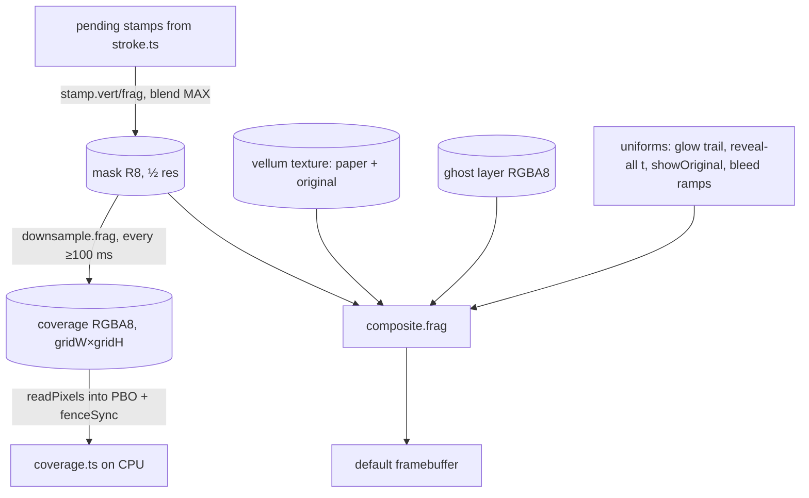

# Design Document

## Overview

`apps/web` is a static Vite app in vanilla TypeScript. The main thread owns the DOM, the WebGL2 vellum and a small state store; a module Web Worker owns every call into `packages/core` (`inspect`, `exorcise`, the Paw). The four screens of the design canvas (Landing, Séance, Exorcism, The Paw) are views mounted by a hash router into one app shell.

The centrepiece is the **scrape pipeline**: pointer or keyboard strokes stamp a soft brush into an R8 mask texture; a composite pass mixes the vellum layer (paper plus the rendered original) with the ghost layer (every ghost's visual, placed by its `GhostLocation`) through that mask, with ink-bleed edge noise and the violet reveal glow (scan lines plus --spectral glow); an asynchronous readback of a downsampled mask feeds a pure coverage function that fires a `reveal` event once a ghost region is more than 35% scraped. Revealed ghosts go into the Séance Ledger and the aria-live announcer, so the shader is never the only way to learn about a ghost.

Design decisions:

- **No framework.** A component is a factory returning `{ el, update, destroy }`. The total UI is a dozen views; a framework would cost most of the 250 KB budget for nothing.
- **Coverage on the CPU, rendering on the GPU.** Rendering stays one full-screen pass; the reveal decision is a pure, unit-testable function over a small `Uint8Array` grid. Pointer and keyboard paths, and the WebGL and fallback renderers, share it.
- **`gl.MAX` blending instead of ping-pong.** WebGL2 has `MAX` in core and R8 is colour-renderable, so stamping needs one framebuffer and no copy.
- **Fixtures as lazy modules, not `fetch`.** A Vite plugin exposes `virtual:haunted-gallery`, whose specimens are separate chunks of inlined bytes. The "no `fetch` in `apps/web/src`" rule stays absolute.
- **CSP as a second wall.** The meta CSP (`connect-src 'self'`) makes an accidental network call fail in the browser, and the Playwright test (G1) proves none is attempted.

## Architecture

### Files

```
apps/web/
  index.html                 CSP meta, font preloads, #app root, live regions
  vite.config.ts             worker format 'es', manualChunks, haunted-gallery plugin
  vite-plugins/haunted-gallery.ts   virtual:haunted-gallery + one chunk per fixture
  public/fonts/              *.woff2 + OFL.txt per family
  src/
    main.ts                  boot: tokens, fonts, shell, router, worker client
    state.ts                 createStore<AppState>()
    router.ts                hash router → view factories
    worker.ts                core calls (inspect, exorcise, paw) behind the protocol
    worker-protocol.ts       zod schemas for every message, both directions
    worker-client.ts         typed request/response over postMessage, AbortSignal mapping
    scrape/
      layout.ts              layoutGhosts(): Ghost[] → GhostRegion[] (pure)
      coverage.ts            coverage(), crossings() (pure)
      stroke.ts              stroke interpolation → stamp list (pure)
      keyboard-grid.ts       12×8 cursor state machine (pure)
      gl.ts                  WebGL2 helpers: program, texture, fbo, PBO readback
    render/
      original.ts            renderOriginal(kind, bytes) → OriginalSurface (image/pdf/docx/placeholder)
      ghost-layer.ts         paints GhostRegion visuals into an OffscreenCanvas → texture
    audio/haunt-audio.ts     Web Audio synth (whisper, choir), created on opt-in
    util/download.ts         saveBytes(name, bytes, mime)
    util/format.ts           bytes, sizes, location → source line
    ui/                      one component per file (below), tokens.css, fonts.css, shaders/
```

### Components (`apps/web/src/ui/`, one file each)

| File | Screen | Responsibility |
|---|---|---|
| `app-shell.ts` | all | header (wordmark, sound toggle, motion override), outlet, live regions |
| `announcer.ts` | all | polite/assertive live regions, 300 ms batching, 500 ms cursor debounce |
| `sound-toggle.ts` | all | `aria-pressed` button, persists `palimpsest.sound`, lazily creates `HauntAudio` |
| `landing-view.ts` | Landing | hero, composes drop zone, promise, gallery |
| `drop-zone.ts` | Landing | label + hidden file input, drag states, 50 MB limit |
| `privacy-promise.ts` | Landing | three pills + explanation dialog |
| `haunted-gallery.ts` | Landing | specimen cards from `virtual:haunted-gallery` |
| `seance-view.ts` | Séance | layout, inspection lifecycle, wires vellum ↔ ledger ↔ announcer |
| `scrape-toolbar.ts` | Séance | Scrape / Reveal all layers / Show original only |
| `reveal-progress.ts` | Séance | "N of M ghosts revealed" + progressbar |
| `vellum-canvas.ts` | Séance | WebGL2 renderer, pointer + keyboard input, reveal events |
| `vellum-fallback.ts` | Séance | DOM renderer for reduced motion / no WebGL2 / context loss |
| `seance-ledger.ts` | Séance | ordered ghost cards, "k more ghosts", exorcise button |
| `ghost-card.ts` | Séance, Exorcism | one ledger card |
| `severity-chip.ts` | all | chip with name text and art-direction colours |
| `unseen-panel.ts` | Séance | "What we can't see": `unchecked`, warnings, out-of-scope list |
| `strike-fade.ts` | Séance | strike-through and fade of removed finding cards |
| `opt-in-map.ts` | Séance | the only module allowed to cause a foreign request (OSM tiles) |
| `exorcism-view.ts` | Exorcism | headline, composes the three blocks below |
| `before-after.ts` | Exorcism | Before list, After list with per-ghost status |
| `verification-panel.ts` | Exorcism | "The Paw tried to break this exorcism" stats |
| `download-button.ts` | Exorcism | "Download clean file" |
| `paw-view.ts` | The Paw | heading, stats, summon/replay, property list |
| `paw-fingers.ts` | The Paw | five decorative fingers, curl animation |
| `curse-trace.ts` | The Paw | "The curse that worked" counterexample panel |
| `tokens.css`, `fonts.css` | all | art-direction tokens, `@font-face` |
| `shaders/*.glsl` | Séance | `fullscreen.vert`, `stamp.vert`, `stamp.frag`, `downsample.frag`, `composite.frag`, `noise.glsl` |

### Data flow

```mermaid
flowchart LR
  subgraph Main thread
    DZ[drop-zone / haunted-gallery] -->|Uint8Array original| ST[(state store)]
    ST --> SV[seance-view]
    SV -->|copy, transfer| WC[worker-client]
    WC -->|Inspection| SV
    SV --> RO[render/original.ts]
    SV --> LY[scrape/layout.ts]
    LY -->|GhostRegion[]| GL[render/ghost-layer.ts]
    RO -->|OriginalSurface| VC[vellum-canvas]
    GL -->|ghost texture| VC
    PTR[pointer / keyboard] --> VC
    VC -->|mask readback grid| CV[scrape/coverage.ts]
    CV -->|reveal ghostId| SV
    SV --> LD[seance-ledger]
    SV --> AN[announcer]
    SV --> AU[haunt-audio opt-in]
    LD -->|exorcise| WC
    WC -->|Exorcism| EV[exorcism-view]
    EV -->|paw quick run| WC
  end
  subgraph Worker
    W[worker.ts] --> CORE[packages/core inspect / exorcise]
    W --> PAW[packages/core/paw lazy]
    CORE -. dynamic import .-> PDF[pdfjs-dist]
    CORE -. dynamic import .-> ZIP[jszip]
  end
  WC <-->|zod-validated messages| W
```

### Scrape render pipeline (per frame)



## Components and Interfaces

All signatures below are the public surface of each module; core shapes come from `@palimpsest/core` (`packages/core/src/types.ts`).

### Component pattern and state

```ts
// state.ts: the component contract and the store
export interface Component<P> { el: HTMLElement; update(props: P): void; destroy(): void }

export interface LoadedFile { name: string; original: Uint8Array; lastModified: number }

export type SeancePhase =
  | { phase: 'inspecting'; startedAt: number }
  | { phase: 'ready'; inspection: Inspection; revealed: ReadonlySet<string> }
  | { phase: 'exorcising'; inspection: Inspection; revealed: ReadonlySet<string> }
  | { phase: 'failed'; message: string };

export interface AppState {
  file: LoadedFile | null;
  seance: SeancePhase | null;
  exorcism: Exorcism | null;
  pawQuick: PawReport | null;      // PawReport: proposed in types.ts (below)
  prefs: { sound: boolean; motion: 'system' | 'reduced' };
}

export interface Store<S> {
  get(): S;
  set(patch: Partial<S> | ((s: S) => Partial<S>)): void;
  subscribe(fn: (s: S) => void): () => void;
}
export function createStore<S>(initial: S): Store<S>;
```

### Router

```ts
export type Route = '#/' | '#/seance' | '#/exorcism' | '#/paw';
export function startRouter(outlet: HTMLElement, store: Store<AppState>,
  views: Record<Route, (store: Store<AppState>) => Component<void>>): () => void;
```

### Worker protocol (`worker-protocol.ts`)

```ts
export type ToWorker =
  | { type: 'inspect'; reqId: number; bytes: Uint8Array; budgetMs: number }
  | { type: 'exorcise'; reqId: number; bytes: Uint8Array; opts: ExorciseOptions }
  | { type: 'paw'; reqId: number; kinds: readonly FileKind[] | 'all'; seed: number;
      maxRuns: number; budgetMs: number; replay?: { property: PawProperty; path: string } }
  | { type: 'docx-text'; reqId: number; bytes: Uint8Array }
  | { type: 'cancel'; reqId: number };

export type FromWorker =
  | { type: 'inspected'; reqId: number; inspection: Inspection }
  | { type: 'exorcised'; reqId: number; exorcism: Exorcism }
  | { type: 'docx-text'; reqId: number; paragraphs: string[] }
  | { type: 'paw-progress'; reqId: number; runs: number; kindsPlanted: number; failures: PawProperty[] }
  | { type: 'paw-done'; reqId: number; report: PawReport }
  | { type: 'error'; reqId: number; code: 'aborted' | 'timeout' | 'internal'; message: string };

export const toWorkerSchema: z.ZodType<ToWorker>;
export const fromWorkerSchema: z.ZodType<FromWorker>;  // Uint8Array fields via z.instanceof(Uint8Array)
```

```ts
// worker-client.ts
export interface WorkerClient {
  inspect(bytes: Uint8Array, opts: { signal?: AbortSignal; budgetMs: number }): Promise<Inspection>;
  exorcise(bytes: Uint8Array, opts: ExorciseOptions, signal?: AbortSignal): Promise<Exorcism>;
  paw(req: { kinds: readonly FileKind[] | 'all'; seed: number; maxRuns: number; budgetMs: number;
             replay?: { property: PawProperty; path: string } },
      onProgress: (p: { runs: number; kindsPlanted: number; failures: PawProperty[] }) => void,
      signal?: AbortSignal): Promise<PawReport>;
  docxText(bytes: Uint8Array): Promise<string[]>;
  dispose(): void;
}
export function createWorkerClient(): WorkerClient;   // new Worker(new URL('./worker.ts', import.meta.url), { type: 'module' })
```

`inspect` and `exorcise` copy before transfer: `const copy = bytes.slice(); postMessage(msg, [copy.buffer])`. The original stays attached to the main thread (G2).

### Core entry points the worker relies on

The worker calls only the public API of `packages/core/src/index.ts`, which the core spec owns. Assumed signatures:

```ts
inspect(bytes: Uint8Array, opts?: { signal?: AbortSignal; adapters?: PlatformAdapters }): Promise<Inspection>;
exorcise(bytes: Uint8Array, opts?: ExorciseOptions & { signal?: AbortSignal; adapters?: PlatformAdapters }): Promise<Exorcism>;
// packages/core/src/paw/index.ts (lazy-loaded by the worker)
summonPaw(opts: { kinds: readonly FileKind[] | 'all'; seed: number; maxRuns: number; signal: AbortSignal;
  replay?: { property: PawProperty; path: string };
  onProgress?(p: { runs: number; kindsPlanted: number; failures: PawProperty[] }): void }): Promise<PawReport>;
```

Coordination requirement on core (not a `types.ts` change): `inspect`/`exorcise` must reach the PDF and DOCX extractors and exorcists through dynamic `import()` after sniffing, so that Vite splits `pdfjs-dist` and `jszip` into on-demand chunks (Requirement 5.6, 22.3). The worker injects browser `PlatformAdapters` (`decodeImage` via `createImageBitmap` + `OffscreenCanvas`, `encodeImage` via `OffscreenCanvas.convertToBlob`). If core's names differ, only `worker.ts` changes.

### Rendering the original (`render/original.ts`)

```ts
export interface OriginalSurface {
  /** Visible content size in vellum units (CSS px at scale 1). */
  width: number; height: number;
  bitmap: ImageBitmap | null;          // null → placeholder (Requirement 6.4)
  /** Maps a location's native space to vellum units. */
  space:
    | { type: 'image'; pxToVellum: number }
    | { type: 'pdf'; pages: { page: number; top: number; viewport: [number, number, number, number, number, number] }[] }
    | { type: 'docx' } | { type: 'placeholder'; label: string };
}
export function renderOriginal(kind: FileKind, bytes: Uint8Array, maxSide: number,
  worker: Pick<WorkerClient, 'docxText'>): Promise<OriginalSurface>;
```

PDF pages are drawn with `pdfjs-dist` (dynamic import; its own worker loaded from a same-origin `?url` asset) into `OffscreenCanvas` at a scale fitting `maxSide`, and the viewport transform from `page.getViewport({ scale })` is kept per page. DOCX visible text is produced in the worker, where `jszip` is already loaded for inspection: `renderOriginal` sends a `docx-text` request and lays the returned paragraphs out with Canvas2D in Geist on a vellum page (deleted runs excluded, inserted runs included, as Word would show them with changes accepted). The 4096 px cap (Requirement 22.5) is `maxSide`.

### Ghost layout (`scrape/layout.ts`)

```ts
export type RegionSource = 'placement' | 'pdf-rect' | 'recovered-anchor' | 'thumbnail-fit' | 'band';
export interface GhostRegion {
  ghostId: string;
  rect: Rect;                     // vellum units, origin top-left of the content union
  source: RegionSource;
  bleed: boolean;                 // severity revenant | wraith → 600 ms bleed-up
}
export interface VellumLayout {
  content: Rect;                  // union of visible content and all non-band regions
  visible: Rect;                  // where the original sits inside content (crop line edge)
  band: Rect | null;              // ghost band below content, null if no band ghosts
  regions: GhostRegion[];
}
export function layoutGhosts(ghosts: readonly Ghost[], surface: OriginalSurface,
  opts: { bandColumnWidth: 280; cardHeight: 96; gap: 16 }): VellumLayout;
export function resolveLocation(loc: GhostLocation): Exclude<GhostLocation, { type: 'nested' }>; // follows container
```

Rules are those of Requirement 6.5, applied in order. PDF conversion: `[x0,y0,x1,y1] = viewport.convertToViewportRectangle([r.x, r.y, r.x + r.width, r.y + r.height])`, normalised (min/max) and offset by the page's `top`. Image placements multiply by `pxToVellum`. Negative coordinates (a placement above or left of the visible image) are allowed; `content` is the union, and `visible` is offset inside it. Band slots fill `max(1, floor(band.width / 280))` columns, rows sorted by `SEVERITY_ORDER.indexOf(severity)` then `id`.

### Ghost layer painting (`render/ghost-layer.ts`)

```ts
export function paintGhostLayer(layout: VellumLayout, ghosts: readonly Ghost[],
  scale: number, maxSide: number): Promise<OffscreenCanvas>;
```

Base fill `#0E2623` (dark teal). Each region is painted into the same canvas: previews are decoded with `createImageBitmap(new Blob([bytes], { type: mime }))` and drawn into the rect; `pdf-region` ghosts without preview get `evidence.summary` in Geist Mono, size reduced until it fits; band slots get a card (title in Geist 600, summary in mono, `--spectral-glow` text). Painting waits for `document.fonts.load()` of both faces. The canvas is uploaded once to an RGBA8 texture.

### WebGL2 vellum (`ui/vellum-canvas.ts`, `scrape/gl.ts`)

```ts
export interface VellumEvents {
  onReveal(ghostIds: string[]): void;      // batched per readback
  onCursor(cell: { col: number; row: number }): void;
  onContextLost(revealed: ReadonlySet<string>): void;
}
export interface VellumProps {
  surface: OriginalSurface; layout: VellumLayout; ghostLayer: OffscreenCanvas;
  tool: 'scrape' | 'none'; showOriginal: boolean; revealed: ReadonlySet<string>;
}
export interface VellumCanvas extends Component<VellumProps> {
  revealAll(): Promise<void>;              // animates mask to 1 over 600 ms
}
export function createVellumCanvas(events: VellumEvents): VellumCanvas | null; // null if no WebGL2
```

**Textures and targets.**

| Name | Format | Size | Purpose |
|---|---|---|---|
| `vellumTex` | RGBA8 | drawing buffer | paper (procedural, baked once with value noise + vellum-200/400/600) with the original composited at `layout.visible` |
| `ghostTex` | RGBA8 | drawing buffer, ≤ 4096 | ghost layer from `paintGhostLayer` |
| `maskTex` + `maskFbo` | R8, LINEAR | `ceil(0.5 × buffer)` | scrape mask, cleared to 0 |
| `covTex` + `covFbo` | RGBA8 | `gridW × gridH` (128 × round(128 × h/w), clamp 16..256) | downsampled mask for readback |
| `bleedTex` | R8 | `regions.length × 1` | per-region bleed-up opacity (0..1), uploaded when ramps change |
| `regionTex` | R8 (region index + 1, NEAREST) | `gridW × gridH` | region lookup for bleed ramps; 0 = none |

**Stamp pass.** `stroke.ts` turns pointer samples into stamps:

```ts
export interface Stamp { x: number; y: number; radius: number; strength: number } // mask texels
export function interpolateStroke(prev: Stamp | null, next: Stamp, spacingFactor: 0.35): Stamp[];
```

Stamps are drawn as instanced quads (`stamp.vert` places a unit quad at `(x, y)` scaled by `radius`); `stamp.frag` outputs `strength × (1 − smoothstep(0.55, 1.0, d))`, `d` = distance from centre / radius. State: `blendEquation(MAX)`, `blendFunc(ONE, ONE)`, viewport = mask size. At most 128 stamps per frame (excess carried to the next frame). Pointer handling: `pointerdown` → `setPointerCapture`; `pointermove` → `getCoalescedEvents()`; pressure maps to `strength = 0.4 + 0.6 × pressure` when `pointerType === 'pen'`, else 1. Keyboard cells stamp a full-strength axis-aligned quad covering the cell (same pass, `d` forced 0).

**Downsample pass.** `downsample.frag` renders `covTex` by averaging a 4 × 4 tap pattern of `maskTex` per output texel (LINEAR sampling gives 16 × 4 = effectively 64 mask texels per tap set), writing the mean into `.r`. Readback: `readPixels(0, 0, gridW, gridH, RGBA, UNSIGNED_BYTE, 0)` into a `PIXEL_PACK_BUFFER`, `fenceSync`, then on a later frame where `clientWaitSync(fence, 0, 0)` is not `TIMEOUT_EXPIRED`, `getBufferSubData` into a reused `Uint8Array`. Readback is scheduled only when stamps were drawn since the last one, at most every 100 ms.

**Composite pass.** `composite.frag` uniforms: `u_vellum`, `u_ghost`, `u_mask`, `u_bleed`, `u_region`, `u_glow[16]` (`vec3`: x, y, age ms), `u_revealAll` (0..1), `u_showOriginal` (0|1), `u_time`, `u_inkColor` (#1D1626), `u_ectoGlow` (#A594FF), `u_ectoText` (#E2DCFF). Per fragment:

1. `m = max(texture(u_mask).r, u_revealAll)`.
2. Ink-bleed edge: `n = fbm4(uv × 18.0 + vec2(0, u_time × 0.00002))` (value noise, 4 octaves, gain 0.5, defined in `noise.glsl`); `e = 4m(1 − m)` (1 at the edge); `m' = smoothstep(0.42, 0.58, m + (n − 0.5) × 0.45 × e)`.
3. Ghost colour: `g = mix(ghost.rgb, u_ectoText, 0.15)`, opacity `a = ghost.a × bleedRamp(region)` where `bleedRamp` = `texture(u_bleed, regionIndex)` for bleed regions, 1 otherwise.
4. Ink ring: `ink = smoothstep(0.25, 0.5, m') × (1 − smoothstep(0.5, 0.8, m'))`; vellum colour darkened `v = mix(vellum.rgb, u_inkColor, 0.55 × ink)`.
5. `col = mix(v, g, m' × a × (1 − u_showOriginal))`.
6. Glow: `glow = Σ exp(−|p − g_i|² / σ²) × (1 − age_i / 800)₊`, σ = 1.6 × brush radius; `col += u_ectoGlow × 0.35 × glow × (1 − u_showOriginal)`.

The frame loop runs only while something changes (strokes, active glow ages < 800 ms, reveal-all or bleed animations); otherwise it idles, so an untouched séance costs no GPU time.

**Context loss.** `webglcontextlost` → `preventDefault`, emit `onContextLost(revealed)`; `seance-view` swaps in `vellum-fallback` with the same revealed set (Requirement 16.4).

### Coverage (`scrape/coverage.ts`)

```ts
export interface MaskGrid { width: number; height: number; data: Uint8Array; stride: 1 | 4 } // .r used
export function regionToCells(rect: Rect, content: Rect, grid: { width: number; height: number }):
  { col: number; row: number; overlap: number }[];      // overlap in [0,1] of each cell's area
export function scrapedFraction(grid: MaskGrid, cells: readonly { col: number; row: number; overlap: number }[]): number;
export function crossings(prev: ReadonlySet<string>, fractions: ReadonlyMap<string, number>, threshold: 0.35): string[];
```

A cell is scraped when `data[i] ≥ 128` (Requirement 9.2). `scrapedFraction = Σ overlap·scraped / Σ overlap`. `crossings` returns ids with `fraction > 0.35` not already in `prev`. `regionToCells` is computed once per layout and cached.

### Keyboard grid (`scrape/keyboard-grid.ts`)

```ts
export interface GridCursor { col: number; row: number }   // 0-based internally, announced 1-based
export type GridKeyResult = { cursor: GridCursor; scrape: GridCursor | null; revealAll: boolean; handled: boolean };
export function handleGridKey(cursor: GridCursor, key: string, shift: boolean): GridKeyResult; // 12 cols × 8 rows
export function cellRect(cell: GridCursor, content: Rect): Rect;
```

### Fallback (`ui/vellum-fallback.ts`)

```ts
export function createVellumFallback(events: VellumEvents): Component<VellumProps> & { revealAll(): void };
```

Draws `surface.bitmap` in a `<canvas>`, each region as an absolutely positioned element (preview `` from a blob URL, or text card) with `opacity: 0`, and keeps a CPU `MaskGrid` (same `gridW × gridH`) updated by pointer path cells and keyboard cells, then runs the same `scrapedFraction` / `crossings`. Revealed regions transition `opacity` over 200 ms.

### Ledger, cards, announcer

```ts
export function sourceLine(loc: GhostLocation, kind: FileKind): string;   // util/format.ts
export function createGhostCard(): Component<{ ghost: Ghost; revealed: boolean; onMap?: () => void }>;
export function createSeverityChip(): Component<{ severity: Severity }>;
export function createSeanceLedger(onExorcise: () => void):
  Component<{ ghosts: readonly Ghost[]; revealed: ReadonlySet<string>; exorcising: boolean }> & { strike(): Promise<void> };

export interface Announcer {
  ghostsRevealed(ghosts: readonly Ghost[]): void;       // batches within 300 ms
  cursor(cell: GridCursor): void;                       // debounced 500 ms
  polite(text: string): void; assertive(text: string): void;
}
export function createAnnouncer(root: HTMLElement): Announcer;
```

Chip colours (from art direction): revenant `background: var(--danger); color: #160606`; wraith `rgba(226,88,43,0.18)` / `#FF8E80`; shade `rgba(232,176,75,0.16)` / `#F2B34C`; wisp `rgba(143,184,177,0.16)` / `#AEB8CC`.

### Exorcism and the Paw views

```ts
export type AfterStatus = 'banished' | 'survived' | 'could-not-check' | 'not-removed';
export function afterStatus(ghost: Ghost, ex: Exorcism): AfterStatus;     // Requirement 14.2, pure
export function cleanFileName(original: string, outKind: FileKind): string; // `${stem}.clean.${ext}`
export function saveBytes(name: string, bytes: Uint8Array, mime: string): void;

export function createPawFingers(): Component<{ curled: ReadonlySet<PawProperty>; reducedMotion: boolean }>;
export function createCurseTrace(): Component<{ counterexample: PawCounterexample | null; runs: number }>;
```

`afterStatus` precedence: `survived` (kind in `verification.ghosts`) > `could-not-check` (kind in `verification.unchecked`) > `banished` (kind in `banished`) > `not-removed`.

### Audio (`audio/haunt-audio.ts`)

```ts
export interface HauntAudio { whisper(severity: Severity): void; choirStart(): void; choirCut(): void; dispose(): void }
export function createHauntAudio(): HauntAudio;   // called only from the sound toggle's click handler
```

Whisper: white-noise `AudioBufferSourceNode` (generated in memory) → two `BiquadFilterNode` bandpasses (formants gliding from ~700/1200 Hz to ~400/900 Hz over 0.9 s; base shifted down 30% for revenant, 15% for wraith) → gain envelope. Choir: six `OscillatorNode`s (triangle, A minor with ±6 cent detune) → lowpass sweeping 300 → 2400 Hz while exorcism runs; `choirCut` ramps gain to 0 in 10 ms. Master `GainNode` capped at 0.25 (≈ −12 dBFS). `visibilitychange` → `suspend()` / `resume()`.

### Opt-in map (`ui/opt-in-map.ts`)

```ts
export function showOptInMap(container: HTMLElement, lat: number, lon: number): { destroy(): void };
export function tileUrlsFor(lat: number, lon: number, zoom: 15): { url: string; dx: number; dy: number }[]; // pure, 3×3
```

The ghost card's button opens a confirmation dialog in `ghost-card.ts`; only "Send and show map" runs `import('./opt-in-map')`. Tiles are ``; CSP permits only `https://tile.openstreetmap.org` for images.

### Haunted Gallery plugin (`vite-plugins/haunted-gallery.ts`)

```ts
// virtual:haunted-gallery
export interface Specimen { id: string; name: string; file: string; description: string;
  expected: { count: number; maxSeverity: Severity }; load(): Promise<Uint8Array> }
export const specimens: readonly Specimen[];
```

The plugin reads `fixtures/haunted-gallery/manifest.json` (written by `scripts/make-fixtures.ts`) and emits `load = () => import('virtual:haunted-gallery/<id>').then(m => m.bytes)`, where each fixture module is base64 decoded into a `Uint8Array`. Each fixture is its own chunk, so none counts toward initial JS.

### Build checks

- `scripts/check-bundle.ts`: reads `dist/.vite/manifest.json`, collects the entry chunk and its static `imports` transitively, gzips each with `zlib.gzipSync(level 9)`, fails above 250 KB, and fails if any initial chunk's module list includes `pdfjs-dist`, `jszip`, `fast-check` or `opt-in-map`.
- `scripts/check-no-network.ts`: AST scan (TypeScript compiler API) of `apps/web/src/**/*.ts` and `packages/core/src/**/*.ts` for the banned identifiers and non-relative `import()` specifiers, with `apps/web/src/ui/opt-in-map.ts` as the only allowed file.

## Data Models

### Proposed change to types.ts

Two additive, backwards-compatible changes. Both are optional for producers; the UI falls back as described when they are absent.

**1. Preview placement.** Image and PDF ghosts need a position for "placed at their pixel rect", and no `GhostLocation` variant carries a pixel rectangle (image ghosts are located by byte range or chunk). Add an optional `placement` to `GhostEvidence.preview`:

```ts
export interface GhostEvidence {
  summary: string;
  fields?: Record<string, string>;
  preview?: {
    mime: 'image/png' | 'image/jpeg'; bytes: Uint8Array; width: number; height: number;
    /**
     * Where the preview sits in the host's visual space: image pixels of the visible image
     * (may extend beyond it, e.g. a recovered crop), or PDF user space on the page named by
     * the ghost's `pdf-region` location. Absent → the UI applies its default placement rules.
     */
    placement?: Rect;
  };
  raw?: unknown;
}
```

Producers: the PNG/JPEG `recovered-image` extractor sets `placement = { x: 0, y: 0, width, height }` of the reconstructed frame; `text-in-pixels` sets the OCR box; PDF `prior-revision` previews set the page's media box.

**2. Paw report.** The Paw suites live in `packages/core/src/paw`, and both the Paw view and the Exorcism verification panel consume their results across the worker boundary, so the report belongs in the shared contract:

```ts
export type PawProperty =
  | 'detects-planted'       // G4
  | 'banishes-removable'    // G3
  | 'original-untouched'    // G2
  | 'never-throws'          // G5
  | 'idempotent-exorcism';  // exorcise(exorcise(f)) banishes nothing further
export const PAW_PROPERTIES: readonly PawProperty[];

export interface PlantedGhost { kind: GhostKind; location: GhostLocation; note: string } // note: "EXIF GPS 51.5033, -0.1196"

export interface PawCounterexample {
  property: PawProperty;
  seed: number;
  path: string;              // fast-check replay path
  shrinks: number;
  curse: { kind: FileKind; size: number; planted: PlantedGhost[] };
  trace: string[];           // human lines: exorcise steps, survivors, minimal description
}

export interface PawReport {
  kinds: FileKind[];
  runs: number;
  kindsPlanted: GhostKind[];
  durationMs: number;
  results: { property: PawProperty; runs: number; holds: boolean; counterexample?: PawCounterexample }[];
}
```

If the core spec prefers to keep these in `packages/core/src/paw/types.ts`, the UI imports them from there unchanged.

### UI-only models

`AppState`, `GhostRegion`, `VellumLayout`, `MaskGrid`, `GridCursor`, `AfterStatus`, `Specimen` as defined above. None duplicates a core shape; they reference `Ghost.id` and `Rect`.

### Fixture manifest (`fixtures/haunted-gallery/manifest.json`)

```ts
interface GalleryManifest { version: 1; specimens: { id: string; name: string; file: string; description: string;
  expected: { count: number; maxSeverity: Severity; kinds: GhostKind[] } }[] }
```

Validated with zod in the Vite plugin; a malformed manifest fails the build.

## Error Handling

| Situation | Behaviour |
|---|---|
| File > 50 MB | Not read; message on landing (Req 2.5). |
| `kind: 'unknown'` | "doesn't know this file type, so nothing was checked" (Req 2.7). No "clean". |
| Worker message fails zod | Dropped, `console.warn`, pending request rejected with `internal` after its timeout. |
| Inspection timeout | Partial inspection shown with warning (Req 5.4). |
| Worker crash (`error` event) | Pending requests rejected; séance shows "The séance was interrupted" with Retry; worker recreated lazily. |
| Original cannot be drawn | Placeholder surface; all ghosts in band (Req 6.4). |
| Preview decode fails | Region falls back to a text card; warning appended to the unseen panel. |
| WebGL2 missing / shader compile or link error / context lost | Fallback renderer (Req 16.1, 16.4); compile log to console in dev. |
| Exorcism fails | Stay on séance, cards restored, message (Req 13.3). |
| Verification finds survivors | Vermilion "<n> ghosts survived", per-row "survived" (Req 14.5). Download remains available but labeled "Download partially cleaned file". |
| Storage unavailable | Defaults used; no error shown (Req 1.5). |
| Audio context creation fails | Toggle reverts to off, polite announcement "Sound isn't available in this browser." |
| Font load timeout (3 s) | Ghost layer painted with fallback stacks (`Georgia`, `ui-monospace`). |

## Correctness Properties

Each maps to a test in the Testing Strategy (`P<n>` tags appear in test names).

1. **P1 Layout totality.** For any `Ghost[]` over any `GhostLocation`, `layoutGhosts` returns exactly one region per ghost id, with finite coordinates and positive width and height.
2. **P2 Band determinism.** Band slot order equals ghosts sorted by `(SEVERITY_ORDER index, id)`, independent of input order.
3. **P3 PDF mapping.** For a page with viewport rotation 0/90/180/270 and any rect inside the page, the mapped region lies inside that page's vellum rect, and mapping the page's full media box yields the page rect.
4. **P4 Content union.** `layout.content` contains `layout.visible` and every non-band region.
5. **P5 Stroke gap bound.** For any two stamps, consecutive outputs of `interpolateStroke` are at most `0.35 × radius` apart and the last output equals the target.
6. **P6 Coverage bounds and monotonicity.** `scrapedFraction ∈ [0, 1]`; increasing any grid value never decreases any region's fraction.
7. **P7 Reveal once.** Across any sequence of grids with non-decreasing values, `crossings` emits each ghost id at most once, and emits it exactly when its fraction first exceeds 0.35.
8. **P8 Keyboard grid closure.** For any key sequence, the cursor stays within 12 × 8; Shift+arrow never produces a scrape; Enter always sets `revealAll`.
9. **P9 Full keyboard reach.** Scraping every cell via arrow keys reveals every ghost (each region crosses 0.35).
10. **P10 After status totality.** `afterStatus` returns exactly one status per ghost and returns `survived` whenever `verification.ghosts` contains its kind.
11. **P11 G2 in the UI.** After `exorcise` through the worker client, the original `Uint8Array` is byte-equal to its snapshot and its buffer is not detached.
12. **P12 Text only.** Rendering a ghost card whose evidence strings contain HTML produces no element children from those strings.
13. **P13 Token fidelity.** `tokens.css` and the art-direction table agree on every token.
14. **P14 G1.** No request leaves the app origin during the full gallery run; tile requests occur only after map confirmation.
15. **P15 Bundle budget.** Initial JS ≤ 250 KB gzip and contains none of the lazy modules.

## Testing Strategy

- **Unit (vitest, jsdom where DOM is needed):** `layout.ts` (P1–P4 with `fast-check` arbitraries for `Ghost` and `GhostLocation`, built only from `types.ts` shapes), `stroke.ts` (P5), `coverage.ts` (P6, P7), `keyboard-grid.ts` (P8, P9), `afterStatus` and `cleanFileName` (P10), `ghost-card.ts` (P12), `sourceLine` table tests for every `GhostLocation` variant, `tokens.test.ts` (P13), `worker-protocol` schemas round-trip and reject malformed messages, `announcer` batching and debounce with fake timers, `tileUrlsFor` against known OSM tile math.
- **Shader smoke (Playwright, Chromium):** compile and link all programs; scrape a scripted stroke across a synthetic layout and read back that the mask under the stroke is ≥ 0.5 and elsewhere 0; assert a `reveal` event fires for a region under the stroke and not for one away from it.
- **End to end (Playwright, Chromium + Firefox):** landing → gallery specimen → séance; keyboard-only séance (Tab to vellum, arrows, Enter) reveals every ghost and the live region text contains each title; reduced motion (`page.emulateMedia({ reducedMotion: 'reduce' })`) uses the fallback and still reveals; context loss (`WEBGL_lose_context`) preserves revealed set; exorcism → download file name `*.clean.*`; Paw view summons and updates stats; accessibility scan with `@axe-core/playwright` on all four screens with zero serious violations.
- **G1 no-network (Playwright):** P14 as in Requirement 23; `context.on('request')`, `page.on('websocket')` and a `context.route('**/*')` recorder against `vite preview`. Runs in CI on every PR.
- **Build checks:** `check-bundle.ts` (P15) and `check-no-network.ts` in `npm run build` / CI.
- **Performance (manual, tagged `@perf`):** a Playwright script on the reference laptop draws a 5 s scripted scrape, collects `requestAnimationFrame` intervals and `PerformanceObserver('longtask')`, and asserts Requirement 22.1. Not CI-gating, because CI GPUs are software rasterisers; results recorded in `docs/DESIGN.md`.
